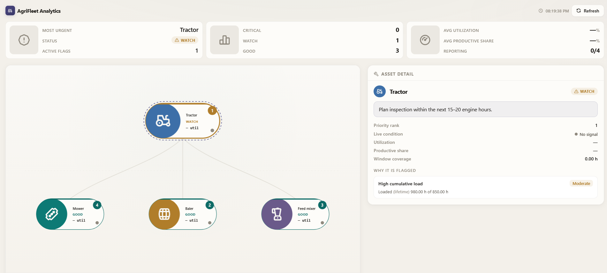
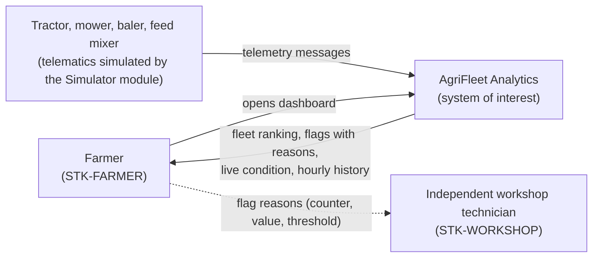

# AgriFleet Analytics

A distributed system that turns telemetry from a small Austrian hay/dairy farm's fleet — one
tractor and three implements — into daily maintenance and operating decisions for the farmer.

## The problem

On the farm, a machine is serviced when the hour meter says a service interval is due or
when someone notices a problem during work. Nothing is recorded: there is no usage log and
no maintenance log. Machines are never compared with each other, so there is no order of
urgency across the fleet. When a job goes to the independent workshop, the technician gets
only a verbal description of the problem.

## The solution

Every morning before work, the farmer opens a dashboard that ranks the whole fleet and shows
each machine's status, a recommendation and the measured reason behind every flag: the
counter, its value and the threshold it crossed. A live strip shows each machine's current
condition, and usage is recorded automatically hour by hour. Every number the system shows
is traceable to a counter, and every counter to a telemetry message. There is no hidden
scoring, no machine learning and no opaque weighting.

## System context

<!-- Copy of docs/SYSTEM-MODEL.md §1. Change both together. -->

## Engineering artifacts

| Method | Artifact |
|--------|----------|
| Stakeholder analysis | [`docs/STAKEHOLDERS.md`](docs/STAKEHOLDERS.md) |
| Business process modeling (BPMN 2.0, as-is / to-be) | [`docs/PROCESS.md`](docs/PROCESS.md) |
| Requirements engineering (35 requirements with MoSCoW priority and source) | [`docs/SPEC.md`](docs/SPEC.md) |
| Traceability (needs → requirements → code → tests) | [`docs/TRACEABILITY.md`](docs/TRACEABILITY.md) |
| System modeling (SysML-style views) | [`docs/SYSTEM-MODEL.md`](docs/SYSTEM-MODEL.md) |
| Architecture (modules, messaging, persistence) | [`docs/ARCHITECTURE.md`](docs/ARCHITECTURE.md) |
| Naming | [`docs/GLOSSARY.md`](docs/GLOSSARY.md) |
| Project management (milestone and work packages) | [Milestone M1 issues](https://github.com/mariolagge/agri-fleet-analytics/issues?q=milestone%3A%22M1+Application-ready+portfolio%22) |
| Running and testing | [`docs/RUNNING.md`](docs/RUNNING.md) |
| Working rules for AI coding agents | [`CLAUDE.md`](CLAUDE.md) |

## Tech stack

Java 25, Spring Boot, RabbitMQ, PostgreSQL, and a frontend of plain HTML/CSS/JavaScript
with no framework, bundler or dependencies.
