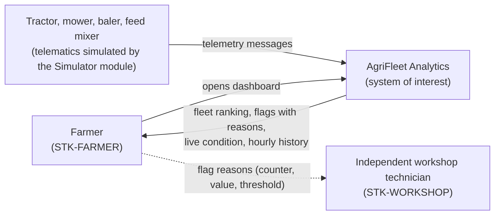
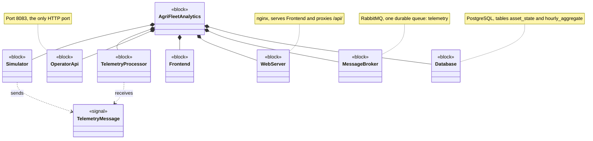
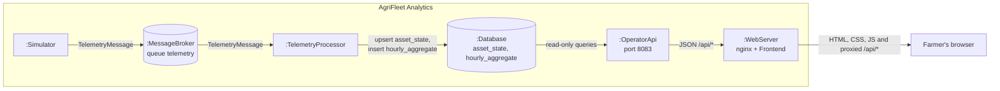
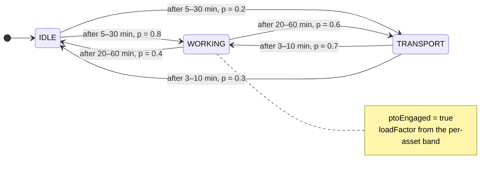
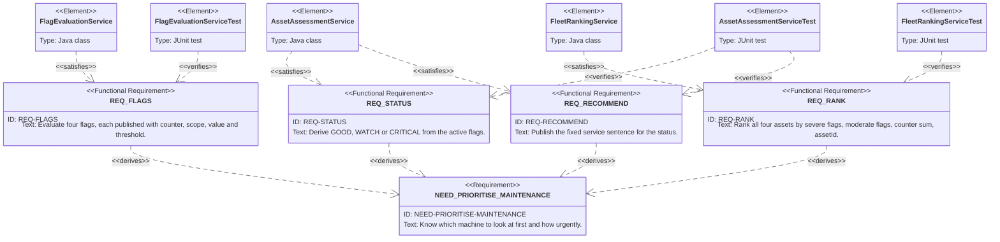

# docs\IMPLEMENTATION-PLAN.md

Work order that turns AgriFleet Analytics into the owner's single portfolio project for two
internship applications in the agricultural-machinery industry. Written to be executed by
coding agents, one phase at a time, top to bottom.

**This file is a transient work order.** It defines no product rule. Every threshold, name
and contract belongs to `SPEC.md`, `ARCHITECTURE.md` or `GLOSSARY.md`; where this plan and
one of those documents disagree, the document wins and the agent stops and reports.
The copy-paste prompts for each phase are in `docs/IMPLEMENTATION-PROMPTS.md`; where a
prompt and this plan disagree, this plan wins. Both files are deleted in Phase P10.

**The repository is public.** No company name of a target employer may appear anywhere in
the repository, including this file.

---

## 0. Agent operating rules

Read these before every phase. They override any default behaviour.

1. **Read order:** `CLAUDE.md` → this file §0–§4 → the phase section → the files listed
   under *Read first* in that phase. Do not start editing before all of them are read.
2. **One phase per run.** Execute exactly one phase, then stop and report (rule 7). Never
   start the next phase on your own.
3. **Never commit, never push, never create GitHub issues.** The owner does all three.
4. **Scope guard (§3) is absolute.** If a step seems to require touching something listed
   as out of scope, stop and ask.
5. **Do not change production behaviour.** No phase changes what any module computes,
   stores or returns. Phases P5 and P6 touch Java files, but only comments (P5) and test
   sources (P6). If a new test fails because the production code violates a REQ, do **not**
   fix the production code — stop and report the failing test and the REQ.
6. **When something is not pinned down** by this plan or the governed documents, ask the
   owner a multiple-choice question instead of guessing.
7. **Stop-and-report format** at the end of every phase:
   1. *Files changed* — a list of paths.
   2. *Acceptance criteria* — every criterion of the phase, each marked ✅ or ❌, with the
      evidence (command and the relevant line of its output).
   3. *Deviations and open questions* — anything not done exactly as written, as
      multiple-choice questions.
   4. *Owner tasks* — the phase's owner tasks still open.
   5. *Suggested commit message* — imperative summary line, a blank line, then
      `Closes #<n>` with `<n>` taken from the *GitHub #* column in §5.
8. **On success**, set the phase's *Status* in §5.1 to `Done (YYYY-MM-DD)`. That is the
   only edit an agent makes to this file, with one exception: in P3, after the owner's
   modeler work, the agent updates the P3 element tables and flow lists to match the saved
   `.bpmn` files.
9. **Environment:** Windows 11, PowerShell. Java 25 is installed. Every Maven command runs
   from inside a module directory with that module's wrapper: `.\mvnw.cmd …`. Quote any
   `-D` argument that contains a comma: `.\mvnw.cmd test "-Dtest=A,B"`.
10. **Never run the `*ApplicationTests` classes.** They need the Docker infrastructure.
    Run only the explicitly listed unit test classes.

---

## 1. Goal

### 1.1 Target roles

The project must give evidence for both roles below. Every artifact in this plan exists
because at least one row of the table needs it.

- **Role A — Systems & Requirements Engineering intern.** Model-based systems engineering
  (MBSE), requirements engineering, system modeling, verification and validation; tools of
  the kind of Siemens Polarion and Cameo Systems Modeler; agile ways of working.
- **Role B — Business Informatics intern (primary focus).** Digitalization, business process
  management and modeling, software conceptualization, requirements engineering, practical
  project management.

| Evidence the roles ask for | Artifact | Phase | Role |
|----------------------------|----------|-------|------|
| Stakeholder analysis, elicitation | `docs/STAKEHOLDERS.md` | P2 | A, B |
| Business process modeling (as-is / to-be), digitalization | `docs/PROCESS.md`, `docs/process/*.bpmn` | P3 | B |
| Requirements with attributes (priority, source) | `docs/SPEC.md` | P4 | A, B |
| Requirements → code traceability | `REQ-…` comments in code | P5 | A |
| Verification against requirements | REQ-tagged unit tests | P6 | A |
| Traceability matrix (Polarion-style) | `docs/TRACEABILITY.md` | P7 | A, B |
| System modeling (SysML-style views) | `docs/SYSTEM-MODEL.md` | P8 | A |
| Project management (milestone, work packages) | GitHub milestone + issues | P0 | B |
| Software conceptualization, communication | `README.md`, `docs/RUNNING.md` | P1, P9 | A, B |

### 1.2 Budget and deadline

- **Deadline:** Milestone *M1 Application-ready portfolio*, due **Sunday 8 Nov 2026**.
  Everything in this plan belongs to M1.
- **Owner time:** about 5 h per week, so about 10 h in total. Agents do the drafting; the
  owner reviews, does the owner tasks, and commits. Owner time per phase is in §5.
- **Weighting:** Role B first. When time runs short, the cut rule in §5.3 removes Role A
  extras first.

---

## 2. Decisions already made

Do not re-open these. They were settled with the owner before the plan was written.

| Topic | Decision |
|-------|----------|
| Weighting of the two roles | Role B (process modeling, project management) first; Role A covered, but cut first. |
| System modeling notation | Mermaid diagrams drawn in SysML style, inside Markdown. Not a SysML tool; the docs say so. |
| Process modeling notation | BPMN 2.0 XML (`.bpmn`) editable in Camunda Modeler / demo.bpmn.io, plus an exported `.svg` for GitHub. |
| BPMN scope | One process only: *maintenance planning*, as-is and to-be. |
| As-is source | The owner's own farm experience: triggers are hour-meter intervals and problems noticed during work; nothing is recorded; the farmer services routine jobs and uses an **independent** workshop for the rest, deciding by job complexity/tools, time pressure in season and cost. |
| To-be trigger | The farmer checks AgriFleet every morning before work. |
| Project management artifacts | GitHub milestone + one issue per phase. The owner creates them by hand from §5.2. No charter, WBS, risk register or sprint log. |
| Business case | None. |
| Stakeholders | Three: farmer (owner/manager), independent workshop technician, developer/maintainer. |
| Stakeholder needs | A new layer above the REQs, in `docs/STAKEHOLDERS.md`. Content is fixed in §6.1. |
| REQ attributes | Two only: **Priority** (MoSCoW) and **Source** (stakeholder needs). Written inline under each REQ in `SPEC.md`. No verification-method attribute. Values are fixed in §6.2. |
| MoSCoW assignment | Proposed by rule in §6.2; the owner reviews that table as part of reviewing this plan. No `Won't` items are added. |
| REQ texts | Unchanged. Bundled REQs are not split. |
| Former "Future work" list | Stays deleted. Not re-added in any form. |
| Code references | Every `SPEC §x` citation in code becomes the REQ ID it refers to (P5). |
| Traceability | REQ ID at the start of every test's `@DisplayName`, plus a hand-maintained Markdown matrix (REQ → implementation → test). No automated check, no verification-method column. |
| New unit tests | Only four classes: `FlagEvaluationServiceTest`, `FleetRankingServiceTest`, `HistoryServiceTest`, `TelemetryGeneratorTest`. |
| System-level tests | None. Unit tests only. |
| Dangling `SPEC.md §0` / `§8` references | Deleted. No document hierarchy is re-added anywhere. |
| Run instructions | New `docs/RUNNING.md`. |
| README | Problem → solution story, dashboard screenshot, embedded system context diagram, engineering artifacts index. |
| Company names | None anywhere in the repository. |
| Branch | Work on `develop`; it is public and is the branch linked in applications. No merge to `main` is part of this plan. |
| Commits | The owner commits after reviewing each phase. Agents never commit. |

---

## 3. Scope guard

### 3.1 In scope

Only the files each phase lists under *Files*.

### 3.2 Out of scope — do not touch

- Production behaviour of any module (see §0 rule 5).
- `CLAUDE.md`, `.cursorrules`, `.vscode/`, `.claude/`.
- `docker/docker-compose.yml`, `docker/nginx-conf/nginx.conf`.
- `docker/database-script.sql` except comment lines in P5.
- `frontend/` except comment lines in P5. No visual or behavioural change.
- `pom.xml` files: no new dependency, plugin or module.
- The three `*ApplicationTests` classes.
- `ARCHITECTURE.md` except the two lines named in P1.
- Every `SPEC §…` reference *inside Markdown documents*. P5 changes code only; the
  governed documents keep their section references.
- Any new language, framework, build tool, CI pipeline, broker or database.

---

## 4. Conventions

### 4.1 New files

| Path | Created in | Owns |
|------|-----------|------|
| `docs/RUNNING.md` | P1 | How to start, test and stop the system |
| `docs/STAKEHOLDERS.md` | P2 | Stakeholders and stakeholder needs (declares `STK-…` and `NEED-…` IDs) |
| `docs/PROCESS.md` | P3 | Business process models: narrative, pain points, to-be changes |
| `docs/process/maintenance-planning-as-is.bpmn` / `.svg` | P3 | As-is BPMN model and its rendering |
| `docs/process/maintenance-planning-to-be.bpmn` / `.svg` | P3 | To-be BPMN model and its rendering |
| `docs/TRACEABILITY.md` | P7 | Derived view: needs → REQs → implementation → tests |
| `docs/SYSTEM-MODEL.md` | P8 | SysML-style views |
| `docs/images/dashboard.png` | P9 (owner) | Dashboard screenshot |
| 4 test classes | P6 | See P6 |

Every new Markdown document starts with a heading of the form `# docs\NAME.md`, matching
`ARCHITECTURE.md` and `GLOSSARY.md`, followed by one sentence stating what the document
owns.

### 4.2 IDs

- `REQ-…` — existing, declared once in `SPEC.md` (`GLOSSARY.md` §1).
- `STK-…` — stakeholder: `STK-` plus one uppercase word. Declared once in `STAKEHOLDERS.md`.
- `NEED-…` — stakeholder need: `NEED-` plus uppercase words separated by hyphens. Declared
  once in `STAKEHOLDERS.md`.
- BPMN element IDs: `AsIs_<Type>_<Name>` / `ToBe_<Type>_<Name>`, PascalCase name, as listed
  in P3. Elements the owner adds in the modeler keep the IDs the modeler generates.

### 4.3 Test conventions

Match the existing test classes (`AssetViewServiceTest` is the reference):

- JUnit 5; `@ExtendWith(MockitoExtension.class)` and `@Mock` only when the class under test
  has a collaborator; no Spring context, no database.
- Plain `assertEquals` / `assertTrue` / `assertNull` / `assertThrows`.
- Same package as the class under test, under `src/test/java`.
- Test method names: long, descriptive camelCase sentences, as in the existing tests.
- Every test has `@DisplayName("<ID>: <plain English sentence>")` where `<ID>` is the
  `REQ-…` it verifies, or `ARCHITECTURE §4` for a test that verifies an `ARCHITECTURE.md`
  rule and no REQ. One ID per test.

### 4.4 Baseline (25 Oct 2026, commit `3430dc2`)

| Module | Unit test classes | Tests | Result |
|--------|-------------------|-------|--------|
| TelemetryProcessor | `CounterAccumulationServiceTest`, `AssetAssessmentServiceTest`, `AssetStatePublisherTest` | 31 | pass |
| OperatorApi | `AssetViewServiceTest` | 9 | pass |
| Simulator | — | 0 | — |

`SPEC.md` declares **35** REQs. In tracked non-Markdown files, **150** lines contain `SPEC`.

---

## 5. Phases

### 5.1 Overview and schedule

| Phase | Title | Depends on | Owner time | Planned | GitHub # | Status |
|-------|-------|-----------|-----------|---------|----------|--------|
| P0 | Milestone and issues (owner only) | — | 0.5 h | Mon 26 Oct | — | Open |
| P1 | Fix stale references, add RUNNING.md | P0 | 0.5 h | Mon 26 Oct | | Done (2026-10-25) |
| P2 | Stakeholders and needs | P1 | 0.5 h | Tue 27 Oct | | Open |
| P3 | BPMN maintenance planning as-is / to-be | P2 | 2.0 h | Wed 28 – Sat 31 Oct | | Open |
| P4 | REQ attributes in SPEC | P2 | 0.5 h | Sun 1 Nov | | Open |
| P5 | REQ IDs in code comments | P4 | 0.5 h | Mon 2 Nov | | Open |
| P6 | REQ-tagged unit tests | P5 | 1.0 h | Tue 3 – Wed 4 Nov | | Open |
| P7 | Traceability matrix | P6 | 0.5 h | Thu 5 Nov | | Open |
| P8 | SysML-style system model | P4, P6 | 1.0 h | Fri 6 Nov | | Open |
| P9 | README front door | P3, P7, P8 | 1.5 h | Sat 7 Nov | | Open |
| P10 | Final consistency review | all | 0.5 h | Sun 8 Nov | | Open |

### 5.2 Issue drafts (owner creates these in P0)

Milestone: **M1 Application-ready portfolio** (exactly this title; P9 links to it by
name), due date 2026-11-08, description:
"Portfolio version linked in internship applications."

One issue per phase P1–P10. For each issue:

- **Title:** `P<n>: <Title from §5.1>`
- **Body:** the phase's *Goal* paragraph and its *Acceptance criteria* list, copied verbatim
  from §7, followed by the line `Milestone M1.`
- **Label:** `enhancement` for P5 and P6, `documentation` for all others (both are GitHub
  default labels).
- **Milestone:** M1.

After creating them, the owner writes each issue number into the *GitHub #* column of §5.1.

### 5.3 Cut rule

Phases P3 (BPMN) and P9 (README) are never cut.

1. If P6 is not done by **Wed 4 Nov** evening: P8 drops `SYSTEM-MODEL.md` §2 (block
   definition) and §3 (internal block).
2. If P8 is not done by **Sat 7 Nov** noon: P8 also drops `SYSTEM-MODEL.md` §4 (state
   machine). §1 (context) and §5 (requirement diagram) always stay.

Record any cut in the *Status* column as `Done, cut <n> (YYYY-MM-DD)`.

---

## 6. Reference data

Fixed content used by several phases. Agents copy from here; they do not invent variants.

### 6.1 Stakeholders and needs (used by P2, P4, P7, P8)

| ID | Stakeholder | Relationship to the system | Main interest |
|----|-------------|----------------------------|---------------|
| `STK-FARMER` | Farmer (owner and manager of the farm) | Primary user; checks the dashboard every morning | Decide which machine to service and how hard to work each machine |
| `STK-WORKSHOP` | Independent workshop technician | Indirect; never uses the system, receives flag reasons from the farmer | Understand why a machine was brought in |
| `STK-DEVELOPER` | Developer / maintainer | Builds and maintains the system | Rules that are traceable, testable and reproducible |

| ID | Stakeholder | Need |
|----|-------------|------|
| `NEED-MONITOR-FLEET` | `STK-FARMER` | The farmer needs to see the condition of all four machines of the farm in one place. |
| `NEED-PRIORITISE-MAINTENANCE` | `STK-FARMER` | The farmer needs to know which machine to look at first and how urgently. |
| `NEED-OPERATIONAL-RISK` | `STK-FARMER` | The farmer needs to know whether it is advisable to keep working a machine hard today. |
| `NEED-UTILIZATION-AWARENESS` | `STK-FARMER` | The farmer needs to see which machines do productive work and which mostly idle or only transport. |
| `NEED-FLAG-REASON` | `STK-WORKSHOP` | The workshop technician needs the measured reason behind a warning — which counter, its value and the threshold it crossed — not only that the machine is critical. |
| `NEED-HISTORY-REVIEW` | `STK-WORKSHOP` | The workshop technician needs to review how a machine was used hour by hour over the past days. |
| `NEED-LIFETIME-HOURS` | `STK-WORKSHOP` | The workshop technician needs the accumulated lifetime hours of a machine, including its hours under load. |
| `NEED-TRACEABLE-RULES` | `STK-DEVELOPER` | The developer needs every number the system shows to be traceable to counters and telemetry, with no hidden scoring. |
| `NEED-REPRODUCIBLE-DEMO` | `STK-DEVELOPER` | The developer needs every run to start from the same known state and to show every status within one demo session. |
| `NEED-STABLE-INTERFACE` | `STK-DEVELOPER` | The developer needs a fixed telemetry message format and a documented, read-only API contract. |

### 6.2 REQ attributes (used by P4, P7)

**MoSCoW rule** (written into the `SPEC.md` preface in P4):

- `Must` — needed for one of the three decisions in REQ-DECISIONS, or for traceability
  (REQ-GOAL-TRACE).
- `Should` — makes results correct or robust, but every decision still works without it.
- `Could` — demo tuning only.

| REQ | Priority | Source |
|-----|----------|--------|
| REQ-GOAL-SCOPE | Must | NEED-MONITOR-FLEET |
| REQ-GOAL-TRACE | Must | NEED-TRACEABLE-RULES, NEED-FLAG-REASON |
| REQ-FLEET-FIXED | Must | NEED-MONITOR-FLEET |
| REQ-TELEMETRY-CADENCE | Should | NEED-STABLE-INTERFACE |
| REQ-TELEMETRY-SHAPE | Must | NEED-STABLE-INTERFACE |
| REQ-TELEMETRY-WORKING-STATUS | Should | NEED-UTILIZATION-AWARENESS |
| REQ-TELEMETRY-PRODUCTIVE | Must | NEED-UTILIZATION-AWARENESS |
| REQ-SIM-ONLY-SOURCE | Must | NEED-REPRODUCIBLE-DEMO |
| REQ-SIM-CYCLE | Must | NEED-REPRODUCIBLE-DEMO |
| REQ-SIM-DEMO | Could | NEED-REPRODUCIBLE-DEMO |
| REQ-SIM-TEMPERATURE | Should | NEED-REPRODUCIBLE-DEMO |
| REQ-SIM-VIBRATION | Should | NEED-REPRODUCIBLE-DEMO |
| REQ-SIM-EXCURSION-RATE | Should | NEED-REPRODUCIBLE-DEMO |
| REQ-SIM-ELEVATED | Should | NEED-REPRODUCIBLE-DEMO |
| REQ-SIM-BURST | Could | NEED-REPRODUCIBLE-DEMO |
| REQ-SIM-MEMORY | Should | NEED-REPRODUCIBLE-DEMO |
| REQ-COUNTER-SET | Must | NEED-UTILIZATION-AWARENESS, NEED-TRACEABLE-RULES |
| REQ-COUNTER-INVARIANT | Must | NEED-TRACEABLE-RULES |
| REQ-ACCUMULATE | Must | NEED-TRACEABLE-RULES |
| REQ-BUCKETS | Must | NEED-HISTORY-REVIEW |
| REQ-SCOPES | Must | NEED-OPERATIONAL-RISK, NEED-LIFETIME-HOURS |
| REQ-BUCKET-EXACT | Should | NEED-TRACEABLE-RULES |
| REQ-BASELINES | Could | NEED-LIFETIME-HOURS, NEED-REPRODUCIBLE-DEMO |
| REQ-UTILIZATION | Must | NEED-UTILIZATION-AWARENESS |
| REQ-FLAGS | Must | NEED-PRIORITISE-MAINTENANCE, NEED-FLAG-REASON |
| REQ-STATUS | Must | NEED-PRIORITISE-MAINTENANCE |
| REQ-LIVE | Must | NEED-OPERATIONAL-RISK |
| REQ-RANK | Must | NEED-PRIORITISE-MAINTENANCE |
| REQ-RECOMMEND | Must | NEED-PRIORITISE-MAINTENANCE |
| REQ-API-COMMON | Must | NEED-STABLE-INTERFACE |
| REQ-API-ASSETS | Must | NEED-PRIORITISE-MAINTENANCE |
| REQ-API-ASSET | Should | NEED-FLAG-REASON |
| REQ-API-HISTORY | Should | NEED-HISTORY-REVIEW |
| REQ-API-LATEST | Should | NEED-OPERATIONAL-RISK |
| REQ-DECISIONS | Must | NEED-PRIORITISE-MAINTENANCE, NEED-OPERATIONAL-RISK, NEED-UTILIZATION-AWARENESS |

Totals: 21 Must, 11 Should, 3 Could = 35. Every NEED in §6.1 appears at least once.

Why the less obvious ones are rated this way:

- REQ-SIM-ONLY-SOURCE and REQ-SIM-CYCLE are `Must` because without them there is no
  telemetry and no working/transport/idle split, so no decision works.
- REQ-API-ASSET, REQ-API-HISTORY and REQ-API-LATEST are `Should` because
  `GET /api/assets` already carries everything the three decisions need.
- REQ-BASELINES is `Could` because it exists only to make the lifetime flag reachable in a
  demo (REQ-BASELINES text says so).

### 6.3 SPEC section → REQ map (used by P5)

| SPEC section | REQs declared there |
|--------------|---------------------|
| §1 | REQ-GOAL-SCOPE, REQ-GOAL-TRACE |
| §2 | REQ-FLEET-FIXED |
| §3.1 | REQ-TELEMETRY-CADENCE, REQ-TELEMETRY-SHAPE, REQ-TELEMETRY-WORKING-STATUS, REQ-TELEMETRY-PRODUCTIVE |
| §3.2 | REQ-SIM-ONLY-SOURCE, REQ-SIM-CYCLE, REQ-SIM-DEMO, REQ-SIM-TEMPERATURE, REQ-SIM-VIBRATION, REQ-SIM-EXCURSION-RATE, REQ-SIM-ELEVATED, REQ-SIM-BURST, REQ-SIM-MEMORY |
| §4.1 | REQ-COUNTER-SET, REQ-COUNTER-INVARIANT |
| §4.2 | REQ-ACCUMULATE |
| §4.3 | REQ-BUCKETS, REQ-SCOPES, REQ-BUCKET-EXACT |
| §4.4 | REQ-BASELINES |
| §4.5 | REQ-UTILIZATION |
| §5.1 | REQ-FLAGS |
| §5.2 | REQ-STATUS |
| §5.3 | REQ-LIVE |
| §5.4 | REQ-RANK |
| §5.5 | REQ-RECOMMEND |
| §6 (top) | REQ-API-COMMON |
| §6.1 | REQ-API-ASSETS |
| §6.2 | REQ-API-ASSET |
| §6.3 | REQ-API-HISTORY |
| §6.4 | REQ-API-LATEST |
| §7 | REQ-DECISIONS |

### 6.4 Existing tests → ID (used by P6)

| Test class | Method | `@DisplayName` ID |
|------------|--------|-------------------|
| `CounterAccumulationServiceTest` | `sealableBucketsIsEmptyWhileTheStreamIsStillInsideTheHour` | ARCHITECTURE §4 |
| | `hourBecomesSealableOnceAMessageOfTheNextHourArrives` | ARCHITECTURE §4 |
| | `sealableBucketsReturnsCopies` | ARCHITECTURE §4 |
| | `sealableBucketsIsRepeatableUntilMarkSealed` | ARCHITECTURE §4 |
| | `deltaAboveSixtySecondsCreditsNothingButAdvancesTheLastProcessedTimestamp` | REQ-ACCUMULATE |
| | `deltaOfExactlySixtySecondsIsCredited` | REQ-ACCUMULATE |
| | `outOfOrderOrDuplicateTimestampUpdatesNothing` | REQ-ACCUMULATE |
| | `firstMessageOfAnAssetCreditsNothing` | REQ-ACCUMULATE |
| | `engineHoursEqualsWorkingPlusTransportPlusIdle` | REQ-COUNTER-INVARIANT |
| | `productiveWorkIsDerivedFromPtoAndGroundSpeedNotFromWorkingStatus` | REQ-TELEMETRY-PRODUCTIVE |
| | `utilizationPercentIsTheQuotientOfTheSnapshotsOwnCountersAndCoverage` | REQ-UTILIZATION |
| | `assetThatNeverReportedHasNoCoverageAndNullPercentages` | REQ-UTILIZATION |
| `AssetAssessmentServiceTest` | the 8 `liveCondition` tests (`messageTwentyHoursOld…` to `freshUnremarkableReadingsAreNormal`) | REQ-LIVE |
| | `oneSevereFlagIsCritical`, `twoModerateFlagsAreCritical`, `oneModerateFlagIsWatch`, `noActiveFlagIsGood` | REQ-STATUS |
| | `eachStatusMapsToItsRecommendation` | REQ-RECOMMEND |
| `AssetStatePublisherTest` | `publishSealsTheHourOnceBothWritesHaveReturned` | ARCHITECTURE §4 |
| | `publishLeavesTheHourSealableWhenTheAssetStateWriteThrows` | ARCHITECTURE §4 |
| | `allFourRowsReachTheRepositoryInOneSaveAllWithDistinctRanks` | REQ-RANK |
| | `resetOnStartupClearsBothTablesAndThenWritesTheBaselines` | REQ-BASELINES |
| | `everyRowOfOnePublishCarriesTheSameUpdatedAt` | ARCHITECTURE §4 |
| | `theSealedHourIsWrittenToHourlyAggregate` | REQ-BUCKETS |
| `AssetViewServiceTest` | `getFleetThrows503WhenNoStateHasBeenPublishedYet` | REQ-API-ASSETS |
| | `getAssetThrows404ForAnUnknownAssetIdWithoutQueryingTheRepository` | REQ-API-ASSET |
| | `getAssetThrows503WhenTheKnownAssetHasNoStoredRow` | REQ-API-ASSET |
| | `getFleetKeepsTheRepositoryOrderAndDoesNotReSortByPriorityRank` | REQ-API-ASSETS |
| | `getLatestTelemetryLeavesTelemetryNullWhenEveryLatestColumnIsNull` | REQ-API-LATEST |
| | `getLatestTelemetryMapsANullReadingToNullAndNotToZero` | REQ-API-LATEST |
| | `anAssetWithNoFlagSeveritySetProducesAnEmptyFlagsList` | REQ-FLAGS |
| | `anActiveFlagCarriesItsCounterScopeValueAndThresholdRoundedToTwoDecimals` | REQ-FLAGS |
| | `getLatestTelemetryReturnsAllFourAssetsInAscendingIdOrderWithTheMissingOnesStale` | REQ-API-LATEST |

`createPublisherWithRealCollaborators` and `createService` are `@BeforeEach` methods, not
tests, and get no `@DisplayName`.

---

## 7. Phase details

### P0 — Milestone and issues (owner only)

**Goal.** Create the M1 milestone and one GitHub issue per phase so that the work is
tracked publicly as work packages.

**Owner tasks**

1. Create the milestone and the ten issues exactly as described in §5.2.
2. Write the issue numbers into the *GitHub #* column of §5.1 and commit this file.

**Acceptance criteria**

- The milestone exists with due date 2026-11-08 and contains ten open issues.
- Every row P1–P10 in §5.1 has an issue number.

---

### P1 — Fix stale references, add RUNNING.md

**Goal.** Remove every reference to the deleted `SPEC.md` §0 and §8 and every claim that
`CLAUDE.md` holds run commands, and move the run instructions into `docs/RUNNING.md`.

**Read first:** `README.md`, `docs/ARCHITECTURE.md` (lines 1–5 and 95–100),
`docs/GLOSSARY.md` (lines 1–5 and 200–204), `docs/SPEC.md` (line 148), and the old run
instructions via `git show 3430dc2^:CLAUDE.md` (section "Common commands").

**Files:** `README.md`, `docs/ARCHITECTURE.md`, `docs/GLOSSARY.md`, `docs/SPEC.md`,
new `docs/RUNNING.md`.

**Steps**

1. `ARCHITECTURE.md` line 3: delete the first sentence (the one that starts with
   "Governed by" and ends with "change protocol)."), so the line starts with
   "This document owns structure, …".
2. `ARCHITECTURE.md` §7, last line: replace the whole line with
   "No AI runtime is part of the system."
3. `GLOSSARY.md` line 3: delete the same first sentence, so the line starts with
   "This document owns **naming only**: …".
4. `GLOSSARY.md` §8, last paragraph: delete the parenthesis that cites `SPEC.md` §8
   (including the space before it), so the paragraph starts with
   "Names retired with the AI layer: *AI Strategy card*, …".
5. `SPEC.md` line 148: replace "— out of scope (§8)." with "— out of scope."
6. `README.md`:
   - Documents table, `CLAUDE.md` row → *Owns*: "Working rules for AI coding agents
     (interview-first coding style)".
   - Documents table, `docs/SPEC.md` row → delete the part starting with "— and, in §0".
   - Documents table → add a row for `docs/RUNNING.md`: "How to start, test and stop the
     system".
   - In the sentence above the table, change "Each of the four documents below" to "Each
     document below".
   - Last paragraph: replace the part that points to `CLAUDE.md` "Common commands" with
     "and `docs/RUNNING.md` for how to run it".
7. Create `docs/RUNNING.md` from the old "Common commands" section, rewritten for a reader
   who has never seen the project, in this order:
   1. Prerequisites: JDK 25, Docker Desktop. Maven is not needed (each module has a wrapper).
   2. Start the infrastructure from `docker/`: `docker compose up -d`.
   3. Start the three modules, each in its own terminal, in this order: `telemetryprocessor`,
      `operatorapi`, `simulator`. Command per module: `.\mvnw.cmd spring-boot:run`
      (Windows) / `./mvnw spring-boot:run` (macOS/Linux). Mention `-Pdev` for low-RAM runs.
   4. Open the dashboard at `http://localhost:8080`. RabbitMQ management UI:
      `http://localhost:15672` (user `admin`, password `admin`).
   5. Run tests: per module `.\mvnw.cmd test`; single class `-Dtest=ClassName`. Note that the
      `*ApplicationTests` context tests need the Docker infrastructure running.
   6. Stop: `Ctrl+C` in each module terminal, then `docker compose down`.
      `docker compose down -v` also deletes the database volume, which is required after
      any change to `docker/database-script.sql`.
   7. Demo knob: `simulator.backfill.hours` in the Simulator's `application.properties`
      (REQ-SIM-BURST); `0` disables the startup burst.

**Acceptance criteria**

- Grep for the regex `§0|SPEC\.md.{0,2} §8|\(§8\)` over `README.md` and `docs/` (excluding
  this file and `IMPLEMENTATION-PROMPTS.md`) returns no match.
- Grep for `Common commands` over `README.md` and `docs/` (excluding this file and
  `IMPLEMENTATION-PROMPTS.md`) returns no match.
- `docs/RUNNING.md` exists and contains all seven parts of step 7.
- Every relative link in `README.md` points to an existing file.

---

### P2 — Stakeholders and needs

**Goal.** Add a stakeholder analysis with ten stakeholder needs that every requirement can
trace back to.

**Read first:** §6.1, `docs/SPEC.md` §1 and §7, `docs/GLOSSARY.md` §1.

**Files:** new `docs/STAKEHOLDERS.md`, `docs/GLOSSARY.md`, `README.md` (documents table only).

**Steps**

1. Create `docs/STAKEHOLDERS.md`:
   - Heading `# docs\STAKEHOLDERS.md` and the sentence: "This document owns the
     stakeholders and their needs. Every requirement in `SPEC.md` names the needs it
     serves in its *Source* attribute."
   - `## 1. Stakeholders` — the first table of §6.1, verbatim.
   - `## 2. Stakeholder needs` — the second table of §6.1, verbatim.
   - `## 3. Elicitation` — exactly this text: "The needs were derived from the author's own
     experience of how machine maintenance is planned on a farm; that as-is process is
     modeled in `PROCESS.md`. They have not been validated in interviews with other
     farmers or workshops."
2. `GLOSSARY.md` §1, naming conventions table: add two rows directly below the
   *Requirement IDs* row:
   - `Stakeholder IDs` | `STK-` plus one uppercase word. Each ID is declared once, in
     `STAKEHOLDERS.md`, and is not listed in this file | `STK-FARMER`
   - `Stakeholder need IDs` | `NEED-` plus uppercase words separated by hyphens. Each ID is
     declared once, in `STAKEHOLDERS.md`, and is not listed in this file | `NEED-FLAG-REASON`
3. `README.md` documents table: add a row for `docs/STAKEHOLDERS.md` →
   `Stakeholders and their needs`.

**Acceptance criteria**

- `STAKEHOLDERS.md` declares exactly 3 `STK-` IDs and 10 `NEED-` IDs, identical to §6.1.
- `GLOSSARY.md` has the two new naming rows.
- No `NEED-` or `STK-` ID appears in any other file except `GLOSSARY.md` examples (this plan
  and `IMPLEMENTATION-PROMPTS.md` excepted).

---

### P3 — BPMN maintenance planning as-is / to-be

**Goal.** Model how the farmer plans machine maintenance today and how that changes with
AgriFleet, as two BPMN 2.0 diagrams with a written analysis of pain points and limits.

**Read first:** §2 (as-is source, to-be trigger), §6.1, `docs/SPEC.md` §5.5 and §7,
`docs/GLOSSARY.md` §6 and §8.

**Files:** new `docs/process/maintenance-planning-as-is.bpmn`,
`docs/process/maintenance-planning-to-be.bpmn`, `docs/PROCESS.md`; `README.md` (documents
table only). The two `.svg` files are created by the owner.

**Modeling rules (both diagrams)**

- Valid BPMN 2.0 XML in the namespace `http://www.omg.org/spec/BPMN/20100524/MODEL`, with
  a `bpmn:collaboration`, `isExecutable="false"` on the process, and a complete
  `bpmndi:BPMNDiagram` section (a shape for every element and participant, an edge for every
  flow). Without diagram interchange data, bpmn.io shows an empty canvas.
- Layout: left to right. Tasks 100×80, events 36×36, gateways 50×50, about 150 px between
  element centres. The expanded *Farmer* pool on top; collapsed pools 60 px high below it.
  The owner tidies the layout afterwards, so aim for readable, not perfect.
- Naming: tasks as verb + object in sentence case, events as states, gateways as questions
  ending in `?`. Outgoing flows of a splitting gateway carry the answer as their name.
- Conditional start events contain
  `<bpmn:conditionalEventDefinition><bpmn:condition xsi:type="bpmn:tFormalExpression" /></bpmn:conditionalEventDefinition>`,
  the timer start event contains `<bpmn:timerEventDefinition />`, and the message catch
  events contain `<bpmn:messageEventDefinition />` — what bpmn.io itself writes.
- IDs of connecting objects, numbered from 1 in the order listed below:
  `<Prefix>_Flow_<n>` for sequence flows, `<Prefix>_Message_<n>` for message flows,
  `<Prefix>_Association_<n>` for annotation associations (`<Prefix>` is `AsIs` or `ToBe`).
- Use only the elements listed below. Add nothing else.

**As-is model** — process `AsIs_Process_MaintenancePlanning`, collaboration
`AsIs_Collaboration`.

| ID | Element | Name |
|----|---------|------|
| `AsIs_Participant_Farmer` | participant, expanded (references the process) | Farmer |
| `AsIs_Participant_Workshop` | participant, collapsed (no process) | Independent workshop |
| `AsIs_Start_HourMeter` | start event, conditional | Hour meter read during daily use |
| `AsIs_Task_CompareInterval` | task | Compare hour meter with service interval from memory |
| `AsIs_Gateway_ServiceDue` | exclusive gateway | Service due? |
| `AsIs_End_NoService` | end event | No service needed |
| `AsIs_Start_ProblemNoticed` | start event, conditional | Problem noticed during work |
| `AsIs_Gateway_MergeTriggers` | exclusive gateway (merge, unnamed) | — |
| `AsIs_Task_AssessJob` | task | Assess job: complexity, tools, time pressure, cost |
| `AsIs_Gateway_DoItMyself` | exclusive gateway | Do it myself? |
| `AsIs_Task_ServiceOnFarm` | task | Service or repair machine on the farm |
| `AsIs_Task_DescribeProblem` | task | Describe problem to workshop |
| `AsIs_Task_BringMachine` | task | Bring machine to workshop |
| `AsIs_Event_MachineRepaired` | intermediate catch event, message | Machine repaired |
| `AsIs_Task_CollectMachine` | task | Collect machine from workshop |
| `AsIs_Gateway_MergeOutcomes` | exclusive gateway (merge, unnamed) | — |
| `AsIs_End_MachineInUse` | end event | Machine back in use |
| `AsIs_Annotation_NoRecord` | text annotation, associated with `AsIs_End_MachineInUse` | Nothing is recorded: no usage log, no maintenance log. |

Sequence flows (in the Farmer pool):

- `AsIs_Start_HourMeter` → `AsIs_Task_CompareInterval` → `AsIs_Gateway_ServiceDue`
- `AsIs_Gateway_ServiceDue` —"No"→ `AsIs_End_NoService`
- `AsIs_Gateway_ServiceDue` —"Yes"→ `AsIs_Gateway_MergeTriggers`
- `AsIs_Start_ProblemNoticed` → `AsIs_Gateway_MergeTriggers`
- `AsIs_Gateway_MergeTriggers` → `AsIs_Task_AssessJob` → `AsIs_Gateway_DoItMyself`
- `AsIs_Gateway_DoItMyself` —"Yes"→ `AsIs_Task_ServiceOnFarm` → `AsIs_Gateway_MergeOutcomes`
- `AsIs_Gateway_DoItMyself` —"No"→ `AsIs_Task_DescribeProblem` → `AsIs_Task_BringMachine`
  → `AsIs_Event_MachineRepaired` → `AsIs_Task_CollectMachine` → `AsIs_Gateway_MergeOutcomes`
- `AsIs_Gateway_MergeOutcomes` → `AsIs_End_MachineInUse`

Message flows:

- `AsIs_Task_DescribeProblem` → `AsIs_Participant_Workshop`, named "Verbal problem description"
- `AsIs_Participant_Workshop` → `AsIs_Event_MachineRepaired`, named "Repair finished"

**To-be model** — process `ToBe_Process_MaintenancePlanning`, collaboration
`ToBe_Collaboration`.

| ID | Element | Name |
|----|---------|------|
| `ToBe_Participant_Farmer` | participant, expanded (references the process) | Farmer |
| `ToBe_Participant_AgriFleet` | participant, collapsed | AgriFleet Analytics |
| `ToBe_Participant_Workshop` | participant, collapsed | Independent workshop |
| `ToBe_Start_Morning` | start event, timer | Every morning before work |
| `ToBe_Task_CheckFleet` | task | Check fleet ranking and live telemetry strip |
| `ToBe_Gateway_AssetStatus` | exclusive gateway | Asset status? |
| `ToBe_Start_ProblemNoticed` | start event, conditional | Problem noticed during work |
| `ToBe_Gateway_MergeCritical` | exclusive gateway (merge, unnamed) | — |
| `ToBe_Task_OpenAssetDetail` | task | Open asset detail: flags with reasons, live condition |
| `ToBe_Task_AssessJob` | task | Assess job: complexity, tools, time pressure, cost |
| `ToBe_Gateway_DoItMyself` | exclusive gateway | Do it myself? |
| `ToBe_Task_ServiceOnFarm` | task | Service or repair machine on the farm |
| `ToBe_Task_SendFlagReasons` | task | Send flag reasons to workshop |
| `ToBe_Task_BringMachine` | task | Bring machine to workshop |
| `ToBe_Event_MachineRepaired` | intermediate catch event, message | Machine repaired |
| `ToBe_Task_CollectMachine` | task | Collect machine from workshop |
| `ToBe_Task_PlanInspection` | task | Plan inspection within the next 15–20 engine hours |
| `ToBe_Gateway_MergeOutcomes` | exclusive gateway (merge, unnamed) | — |
| `ToBe_Task_PlanMachineUse` | task | Plan machine use from live condition and 24 h flags |
| `ToBe_End_UsePlanned` | end event | Machine use planned |
| `ToBe_Annotation_Repeat` | text annotation, associated with `ToBe_Gateway_AssetStatus` | Repeated for each asset in rank order, from this gateway to the merge before planning machine use. |
| `ToBe_Annotation_Intervals` | text annotation, associated with `ToBe_Task_CheckFleet` | Manufacturer service intervals are not part of AgriFleet: the hour-meter check of the as-is process continues unchanged. |
| `ToBe_Annotation_Records` | text annotation, associated with `ToBe_End_UsePlanned` | Usage is recorded automatically (counters, hourly history). Performed maintenance is still not recorded. |

Sequence flows (in the Farmer pool):

- `ToBe_Start_Morning` → `ToBe_Task_CheckFleet` → `ToBe_Gateway_AssetStatus`
- `ToBe_Gateway_AssetStatus` —"CRITICAL"→ `ToBe_Gateway_MergeCritical`
- `ToBe_Gateway_AssetStatus` —"WATCH"→ `ToBe_Task_PlanInspection` → `ToBe_Gateway_MergeOutcomes`
- `ToBe_Gateway_AssetStatus` —"GOOD"→ `ToBe_Gateway_MergeOutcomes`
- `ToBe_Start_ProblemNoticed` → `ToBe_Gateway_MergeCritical`
- `ToBe_Gateway_MergeCritical` → `ToBe_Task_OpenAssetDetail` → `ToBe_Task_AssessJob` →
  `ToBe_Gateway_DoItMyself`
- `ToBe_Gateway_DoItMyself` —"Yes"→ `ToBe_Task_ServiceOnFarm` → `ToBe_Gateway_MergeOutcomes`
- `ToBe_Gateway_DoItMyself` —"No"→ `ToBe_Task_SendFlagReasons` → `ToBe_Task_BringMachine`
  → `ToBe_Event_MachineRepaired` → `ToBe_Task_CollectMachine` → `ToBe_Gateway_MergeOutcomes`
- `ToBe_Gateway_MergeOutcomes` → `ToBe_Task_PlanMachineUse` → `ToBe_End_UsePlanned`

Message flows:

- `ToBe_Participant_AgriFleet` → `ToBe_Task_CheckFleet`, named "Ranking, status, recommendation, live condition"
- `ToBe_Participant_AgriFleet` → `ToBe_Task_OpenAssetDetail`, named "Flags with counter, value, threshold"
- `ToBe_Task_SendFlagReasons` → `ToBe_Participant_Workshop`, named "Flag reasons: counter, value, threshold"
- `ToBe_Participant_Workshop` → `ToBe_Event_MachineRepaired`, named "Repair finished"

**`docs/PROCESS.md` content**

- Heading `# docs\PROCESS.md` and the sentence: "This document owns the business process
  models. Notation: BPMN 2.0. The `.bpmn` files in `process/` are the source; the `.svg`
  files are exported from them with Camunda Modeler or demo.bpmn.io."
- `## 1. As-is: maintenance planning without AgriFleet` — the image
  `process/maintenance-planning-as-is.svg`, then one paragraph walking through the model
  from both start events to the end, using the element names, and the sentence "Source:
  the author's own farm experience (see `STAKEHOLDERS.md` §3)."
- `## 2. Pain points` — a table *# | Pain point | Where it shows in the as-is model |
  Addressed by*, with exactly these rows:

  | # | Pain point | Where it shows | Addressed by |
  |---|------------|----------------|--------------|
  | 1 | Machines are never compared; there is no order of urgency across the fleet. | Both start events concern one machine; no step looks at the others | NEED-PRIORITISE-MAINTENANCE, NEED-MONITOR-FLEET |
  | 2 | Problems are found only when someone notices them during work. | *Problem noticed during work* | NEED-OPERATIONAL-RISK |
  | 3 | The workshop receives only a verbal description of the problem. | *Verbal problem description* | NEED-FLAG-REASON |
  | 4 | Neither usage nor maintenance is recorded. | *Nothing is recorded* annotation | NEED-HISTORY-REVIEW, NEED-LIFETIME-HOURS (usage only) |
  | 5 | The service interval is compared from memory. | *Compare hour meter with service interval from memory* | Not addressed (see §4) |

- `## 3. To-be: maintenance planning with AgriFleet` — the image
  `process/maintenance-planning-to-be.svg`, then one paragraph walking through it, and a
  table *Gateway or task | Decision in REQ-DECISIONS* with these rows:
  `Asset status?` → 1 Maintenance prioritisation;
  `Open asset detail: flags with reasons, live condition` → 1 Maintenance prioritisation;
  `Plan machine use from live condition and 24 h flags` → 2 Short-term operational risk.
  Follow it with the sentence: "Decision 3, basic utilization awareness, supports
  longer-term planning and is not part of this daily process."
- `## 4. What does not change` — four bullets: manufacturer service intervals stay a manual
  hour-meter check; performed maintenance is still not recorded (the system has no
  maintenance log); the system sends no notifications, so the farmer has to look; the
  workshop never uses the system and gets the flag reasons only through the farmer.

**Owner tasks** (after the agent's draft)

1. Open each `.bpmn` in demo.bpmn.io or Camunda Modeler. Correct anything that does not
   match the owner's farm experience; tidy the layout. Save over the same `.bpmn` file.
2. Export each diagram as SVG next to it, with the same base name.
3. Tell the agent to re-run the acceptance criteria.

If the owner adds, removes or renames elements in step 1, the owner's version wins: the
agent updates the element and flow lists in this phase and the text of `PROCESS.md` to
match the saved `.bpmn` files, and lists the changes in its report. Owner-created elements
keep the IDs the modeler generated. The agent never edits the saved `.bpmn` or `.svg` files.

**Acceptance criteria**

- Both `.bpmn` files parse as XML: `[xml](Get-Content <file> -Raw)` in PowerShell raises no
  error.
- Every ID in the two element tables above exists in its file, and the file contains no
  other flow node (task, event or gateway).
- Both files open in demo.bpmn.io without an import warning (owner confirms).
- Both `.svg` files exist and are embedded in `PROCESS.md` with relative paths.
- `PROCESS.md` has sections 1–4 with the content listed above.
- The `README.md` documents table has a row for `docs/PROCESS.md` →
  `Business process models (BPMN 2.0): maintenance planning as-is and to-be`.

---

### P4 — REQ attributes in SPEC

**Goal.** Give every requirement in `SPEC.md` a MoSCoW priority and the stakeholder needs it
serves, written directly under the requirement.

**Read first:** §6.2, `docs/SPEC.md` (whole file), `docs/STAKEHOLDERS.md`.

**Files:** `docs/SPEC.md`.

**Steps**

1. Insert at the very top of `SPEC.md`, before `## 1. Goal`:
   - The heading `# docs\SPEC.md`.
   - The sentence "This document owns the product rules: requirements, domain logic, API
     contract and scope."
   - The paragraph "Each requirement (`REQ-…`) is followed by two attributes. **Priority**
     uses MoSCoW:" followed by the three-bullet MoSCoW rule from §6.2 verbatim, and then
     "**Source** lists the stakeholder needs (`NEED-…`, `STAKEHOLDERS.md` §2) the
     requirement serves."
   - A `---` separator.
2. For each of the 35 REQs, insert one new paragraph directly after the paragraph that
   declares it (the one starting with `**REQ-…**`), before any table, list, code block or
   explanatory prose that follows. Format, exactly:

   `*Priority: Must · Source: NEED-PRIORITISE-MAINTENANCE, NEED-FLAG-REASON*`

   with the values from §6.2. The separator is a middle dot (U+00B7) with one space on each
   side.
3. Change nothing else in `SPEC.md`.

**Acceptance criteria**

- Grep count of `^\*Priority: (Must|Should|Could) · Source: NEED-` in `SPEC.md` is 35.
- Grep count of `^\*\*REQ-[A-Z-]+\.\*\*` in `SPEC.md` is still 35.
- Counts per priority: 21 `Must`, 11 `Should`, 3 `Could`.
- Every `NEED-` ID used in `SPEC.md` is declared in `STAKEHOLDERS.md`.
- `git diff docs/SPEC.md` shows only added lines.

---

### P5 — REQ IDs in code comments

**Goal.** Replace every `SPEC §…` citation in code with the stable requirement ID it refers
to, so code can be traced to requirements by searching for the ID.

**Read first:** §6.3, `docs/SPEC.md`. List every occurrence with
`git grep -n "SPEC" -- ":!*.md"` (expected: 150 lines).

**Files:** every tracked non-Markdown file that contains `SPEC` — Java (main and test),
`frontend/` JS, CSS and HTML, `docker/database-script.sql`, the `application.properties`
files. Untracked `target/` folders are ignored.

**Rules**

1. Replace the reference, not the sentence. `SPEC §4.2` and `SPEC.md §4.2` both become
   `REQ-ACCUMULATE`. Sub-references stay: `SPEC §4.2 step 3` → `REQ-ACCUMULATE step 3`;
   `SPEC §5.4 criterion 3` → `REQ-RANK criterion 3`.
2. A bare section reference that belongs to an earlier `SPEC` in the same comment is
   replaced too: `SPEC §4.1 counters, lifetime scope (§4.4 baselines + this run)` →
   `REQ-COUNTER-SET counters, lifetime scope (REQ-BASELINES + this run)`.
3. A section with one REQ in §6.3 maps to it directly. For a section with several REQs,
   choose the REQ whose *shall* the commented code implements, after reading that REQ's text.
   If the code implements more than one, list them: `REQ-API-ASSETS and REQ-API-ASSET`.
4. `SPEC §6` without a subsection refers to the common API rules → `REQ-API-COMMON`.
5. A reference to a SPEC statement that is not part of any REQ stays a section reference,
   written `SPEC §x`. Known case: `frontend/js/format.js` cites `SPEC.md §8` for DST being
   out of scope; that sentence now lives in `SPEC.md` §4.3 prose, so it becomes `SPEC §4.3`.
6. References to `ARCHITECTURE.md §…` and `GLOSSARY §…` stay unchanged.
7. Change only comments. If `SPEC` appears outside a comment (string literal, identifier),
   leave it and list it in the report.

**Acceptance criteria**

- `git grep -n "SPEC" -- ":!*.md"` lists only references allowed by rule 5 or rule 7, each
  named in the report.
- `git diff -U0 -- ":!*.md" | grep -E "^[+-]" | grep -vE "^(\+\+\+|---)" | grep -vE "^[+-]\s*(//|\*|/\*|#|--|<!--)"`
  (run in the Bash tool) prints nothing, or only lines whose change is a trailing comment on
  otherwise unchanged code.
- Every `REQ-` ID that now appears in code is one of the 35 declared in `SPEC.md`.
- `.\mvnw.cmd -q compile` succeeds in `simulator`, `telemetryprocessor` and `operatorapi`.
- The baseline unit tests (§4.4) still pass.

---

### P6 — REQ-tagged unit tests

**Goal.** Label every existing service test with the requirement it verifies and add tests
for the four requirement-bearing classes that have none.

**Read first:** §4.3, §6.4, `docs/SPEC.md` REQ-FLAGS, REQ-RANK, REQ-API-HISTORY,
REQ-TELEMETRY-WORKING-STATUS and REQ-TELEMETRY-SHAPE, the four classes under test, and
`AssetViewServiceTest` as the style reference.

**Files:** the four existing test classes; four new test classes:

- `telemetryprocessor/src/test/java/com/mariolagger/telemetryprocessor/service/business/FlagEvaluationServiceTest.java`
- `telemetryprocessor/src/test/java/com/mariolagger/telemetryprocessor/service/business/FleetRankingServiceTest.java`
- `operatorapi/src/test/java/com/mariolagger/operatorapi/service/business/HistoryServiceTest.java`
- `simulator/src/test/java/com/mariolagger/simulator/service/business/TelemetryGeneratorTest.java`

**Steps**

1. **Existing tests.** Add `@DisplayName("<ID>: <sentence>")` to every test method listed
   in §6.4, with the ID from that table and a plain-English sentence restating the method
   name. Add the `org.junit.jupiter.api.DisplayName` import. Do not rename methods or change
   their bodies.
2. **`FlagEvaluationServiceTest`** — no mocks; `new FlagEvaluationService()` and `CounterSet`
   built through its constructor. Thresholds are the literal numbers from the REQ-FLAGS
   tables. Six tests, all `REQ-FLAGS`:
   1. `highLoadHours` 1.4 → `heavyRecentUse` is inactive (severity, value and threshold null).
   2. `highLoadHours` 1.5 → `MODERATE`, value 1.5, threshold 1.5.
   3. `highLoadHours` 3.0 → one `SEVERE` evaluation with threshold 2.5, not 1.5.
   4. Only `tempExcursionHours` 0.8 set → `thermalLoad` is `MODERATE`; `heavyRecentUse` and
      `mechanicalAttention` are inactive.
   5. `vibrationAlertHours` 2.0 → `mechanicalAttention` is `SEVERE` with threshold 2.0.
   6. Lifetime `loadedHours` 850 → `highCumulativeLoad` is `MODERATE`; 1200 → `SEVERE`.
3. **`FleetRankingServiceTest`** — no mocks. Both input maps must contain all four assets,
   because `assignPriorityRanks` looks up every `AssetId`. Five tests, all `REQ-RANK`:
   1. One `SEVERE` flag outranks two `MODERATE` flags.
   2. With equal `SEVERE` counts, more `MODERATE` flags ranks higher.
   3. With equal flag counts, the larger `highLoadHours + tempExcursionHours +
      vibrationAlertHours` (24 h) ranks higher.
   4. With everything equal, ranks follow `assetId` ascending: BALER 1, MIXER 2, MOWER 3,
      TRACTOR 4.
   5. The result holds the ranks 1, 2, 3 and 4, each exactly once.
4. **`HistoryServiceTest`** — `@Mock HourlyAggregateRepository`. Eight tests, all
   `REQ-API-HISTORY`:
   1. Missing `from` → `ResponseStatusException` with 400.
   2. Unparseable `to` → 400.
   3. `from` equal to `to` → 400.
   4. Range of 7 days plus 1 second → 400.
   5. Range of exactly 7 days → no exception.
   6. Valid range with `assetId` `"PLOUGH"` → 404.
   7. Repository returns no rows → response with an empty `rows` list, no exception.
   8. Without `assetId`, the all-assets finder is called with `to` and `from` minus one
      hour, and the rows come back in the repository's order.

   Mockito runs with strict stubs: stub only what a test uses.
5. **`TelemetryGeneratorTest`** — no mocks. For each `AssetId`, create
   `new AssetSimulationState(assetId)` and call `generate` 2,000 times with timestamps 60 s
   apart, starting at `2026-08-13T00:00:00Z`. Two tests:
   1. `REQ-TELEMETRY-WORKING-STATUS`: on every message, `workingStatus == WORKING` exactly
      when `ptoEngaged && groundSpeedKmh > 2`.
   2. `REQ-TELEMETRY-SHAPE`: on every message, `groundSpeedKmh >= 0`,
      `0.0 <= loadFactor <= 1.0`, `assetId` equals the state's asset and `timestamp` equals
      the instant passed in.

   The generator uses an unseeded `Random`. Both assertions hold on every random path, so
   the tests are still deterministic in outcome. Do not add a seed or change the generator.

**Acceptance criteria**

- In `telemetryprocessor`:
  `.\mvnw.cmd test "-Dtest=CounterAccumulationServiceTest,AssetAssessmentServiceTest,AssetStatePublisherTest,FlagEvaluationServiceTest,FleetRankingServiceTest"`
  → 42 tests, 0 failures.
- In `operatorapi`: `.\mvnw.cmd test "-Dtest=AssetViewServiceTest,HistoryServiceTest"` →
  17 tests, 0 failures.
- In `simulator`: `.\mvnw.cmd test "-Dtest=TelemetryGeneratorTest"` → 2 tests, 0 failures.
- Every `@Test` method in the eight service test classes has a `@DisplayName` starting with
  a declared `REQ-` ID or `ARCHITECTURE §4`.
- No production file changed (`git diff --stat -- "*/src/main/*"` is empty).

---

### P7 — Traceability matrix

**Goal.** Publish one table that traces every stakeholder need to its requirements and every
requirement to the code that implements it and the tests that verify it.

**Read first:** `docs/SPEC.md`, `docs/STAKEHOLDERS.md`, the output of
`git grep -n "REQ-" -- "*/src/main/*" frontend docker` and of
`git grep -n "@DisplayName" -- "*/src/test/*"`.

**Files:** new `docs/TRACEABILITY.md`; `README.md` (documents table only).

**Content**

- Heading `# docs\TRACEABILITY.md` and the sentence: "This document is a derived view, built
  by hand from the *Source* attributes in `SPEC.md`, the `REQ-` comments in the code and the
  `@DisplayName` of the unit tests. Where it disagrees with those, they win. Update it in the
  same change as any of them."
- `## 1. Stakeholder needs → requirements` — columns *Need | Stakeholder | Requirements*. One
  row per NEED in `STAKEHOLDERS.md` order; *Requirements* lists every REQ whose *Source*
  names that NEED, in `SPEC.md` order.
- `## 2. Requirements → implementation → verification` — columns *Requirement | Priority |
  Implemented in | Verified by*. One row per REQ in `SPEC.md` order.
  - *Implemented in*: the file names (class name for Java, file name otherwise) under
    `src/main`, `frontend/` and `docker/` whose comments cite the REQ, each prefixed with one
    of `Simulator`, `TelemetryProcessor`, `OperatorApi`, `frontend`, `docker`:
    `TelemetryProcessor: FlagEvaluationService`, `frontend: fleet.js`,
    `Simulator: application.properties`. If none: `—`.
  - *Verified by*: each test class with at least one `@DisplayName` starting with the REQ,
    followed by the number of such tests: `FlagEvaluationServiceTest (6)`. If none: `—`.
- `## 3. Coverage` — three lines: number of REQs with at least one test, out of 35; the list
  of `Must` REQs with no test; the statement "Tests labelled `ARCHITECTURE §4` verify
  `ARCHITECTURE.md` rules and are not listed above."

**Acceptance criteria**

- Table 1 has 10 rows; table 2 has 35 rows; each REQ ID appears exactly once in table 2.
- Spot check by the agent, for five REQs chosen across §3–§6 of SPEC: *Implemented in* and
  *Verified by* match the two `git grep` outputs.
- The `README.md` documents table has a row for `docs/TRACEABILITY.md` →
  `Traceability: needs → requirements → code → tests`.

---

### P8 — SysML-style system model

**Goal.** Show the system as SysML-style views — context, structure, behaviour and
requirements — drawn in Mermaid so that they render on GitHub.

**Read first:** `docs/ARCHITECTURE.md` §1–§5, `docs/SPEC.md` REQ-SIM-CYCLE, REQ-FLAGS,
REQ-STATUS, REQ-RANK, REQ-RECOMMEND, `docs/STAKEHOLDERS.md`.

**Files:** new `docs/SYSTEM-MODEL.md`; `README.md` (documents table only).

**Document frame**

- Heading `# docs\SYSTEM-MODEL.md` and the paragraph: "This document holds SysML-style views
  of the system, drawn in Mermaid so that they render on GitHub. Mermaid is not a SysML
  tool: the views borrow SysML diagram kinds and notation but are not a SysML model. They
  are views of `SPEC.md` and `ARCHITECTURE.md`; where a view and those documents disagree,
  the documents win."
- A table *SysML diagram | Mermaid diagram type | Section*: System context → flowchart → §1;
  Block definition diagram → classDiagram → §2; Internal block diagram → flowchart → §3;
  State machine diagram → stateDiagram-v2 → §4; Requirement diagram → requirementDiagram → §5.
- Each section: one sentence saying what the view shows, the diagram, and a line
  `Source: …` naming the REQs or `ARCHITECTURE.md` sections it is drawn from.
- Use the diagram sources below verbatim. If one fails to render, change only the syntax,
  never the content, and report the change.

**§1 System context** — source: `SPEC.md` §1–§2, `STAKEHOLDERS.md` §1.

Below the diagram, the sentence: "The developer (`STK-DEVELOPER`) has no runtime interface
and is therefore not shown."

**§2 Block definition diagram** — source: `ARCHITECTURE.md` §1–§3.

**§3 Internal block diagram** — source: `ARCHITECTURE.md` §1, §3–§5.

**§4 State machine: simulator working cycle** — source: REQ-SIM-CYCLE.

Below the diagram, the sentence: "Each of the four assets runs its own instance of this
machine. The initial state `IDLE` is an implementation choice in `AssetSimulationState`;
REQ-SIM-CYCLE does not fix it."

**§5 Requirement diagram: maintenance prioritisation slice** — source:
`STAKEHOLDERS.md`, REQ-FLAGS, REQ-STATUS, REQ-RANK, REQ-RECOMMEND, `TRACEABILITY.md`.

Arrows follow SysML direction: `derives` points from the derived requirement to its source,
`satisfies` from the implementing class to the requirement, `verifies` from the test to the
requirement.

Below the diagram, the sentence: "This is one slice of the full trace in `TRACEABILITY.md`.
REQ-FLAGS also serves NEED-FLAG-REASON, which this slice does not show."

**Acceptance criteria**

- `SYSTEM-MODEL.md` contains the frame and the five sections (minus any cut under §5.3).
- Each Mermaid block renders without error on https://mermaid.live (owner pastes each one,
  or checks the file on GitHub after pushing `develop`).
- Every class and test named in §5 exists in the repository.
- The `README.md` documents table has a row for `docs/SYSTEM-MODEL.md` →
  `SysML-style system views: context, blocks, state machine, requirements`.

---

### P9 — README front door

**Goal.** Rewrite `README.md` so that a recruiter understands the problem, the solution and
the engineering methods within two minutes, and an engineer finds every artifact.

**Read first:** current `README.md`, `docs/PROCESS.md` §1–§3, `docs/SYSTEM-MODEL.md` §1,
`docs/STAKEHOLDERS.md`.

**Files:** `README.md`; `docs/images/dashboard.png` (owner).

**Owner task (before the agent starts):** start the system (`docs/RUNNING.md`), wait until
the startup burst has finished and all four assets show a status, take a screenshot of the
full dashboard in a browser window about 1400 px wide, and save it as
`docs/images/dashboard.png`.

**Structure, in this order**

1. `# AgriFleet Analytics` and one sentence: what the system is, for whom.
2. `## The problem` — 3 to 5 sentences, consistent with `PROCESS.md`: on the farm, service
   is triggered by the hour meter or by a problem noticed during work; nothing is recorded;
   machines are not compared; the workshop gets only a verbal description.
3. `## The solution` — 3 to 5 sentences: every morning the farmer sees a ranked fleet with
   status, recommendation and the measured reason behind every flag, plus each machine's
   live condition; usage is recorded hour by hour. Then the existing principle that every
   number is traceable to a counter and every counter to telemetry, with no hidden scoring.
4. The image ``.
5. `## System context` — the comment line
   `<!-- Copy of docs/SYSTEM-MODEL.md §1. Change both together. -->` followed by the §1
   Mermaid block, character for character.
6. `## Engineering artifacts` — one table *Method | Artifact*, replacing the old documents
   table, with these rows in this order:
   - Stakeholder analysis → `docs/STAKEHOLDERS.md`
   - Business process modeling (BPMN 2.0, as-is / to-be) → `docs/PROCESS.md`
   - Requirements engineering (35 requirements with MoSCoW priority and source) → `docs/SPEC.md`
   - Traceability (needs → requirements → code → tests) → `docs/TRACEABILITY.md`
   - System modeling (SysML-style views) → `docs/SYSTEM-MODEL.md`
   - Architecture (modules, messaging, persistence) → `docs/ARCHITECTURE.md`
   - Naming → `docs/GLOSSARY.md`
   - Project management (milestone and work packages) →
     `https://github.com/mariolagge/agri-fleet-analytics/issues?q=milestone%3A%22M1+Application-ready+portfolio%22`
     (lists the milestone's open and closed issues)
   - Running and testing → `docs/RUNNING.md`
   - Working rules for AI coding agents → `CLAUDE.md`
7. `## Tech stack` — the existing sentence on Java 25, Spring Boot, RabbitMQ, PostgreSQL and
   the plain HTML/CSS/JavaScript frontend.

**Acceptance criteria**

- The README has the seven parts in the listed order and is at most 90 lines long.
- The Mermaid block in part 5 is identical to `SYSTEM-MODEL.md` §1 (compare the two blocks).
- Every relative link and the image path point to existing files.
- No company name of a target employer appears.

---

### P10 — Final consistency review

**Goal.** Check that all M1 artifacts agree with each other and remove this work order.

**Read first:** every file changed in P1–P9.

**Files:** any file from P1–P9 that needs a consistency fix; this file and
`docs/IMPLEMENTATION-PROMPTS.md` (both deleted).

**Steps**

1. Re-run the acceptance criteria of P1, P4, P5, P6 and P7 and fix any drift.
2. Grep the whole repository, case-insensitive, for the target employers' names and their
   parent group's name; there must be no match anywhere. (The owner tells the agent the
   three names in the chat; they are not written into the repository.)
3. Check that every `NEED-`, `STK-` and `REQ-` ID used anywhere (the two work-order files
   excepted) is declared exactly once in its owning document.
4. Check every relative link in all Markdown files under `docs/` and in `README.md`.
5. After the owner confirms that P1–P9 are committed and their issues closed, delete
   `docs/IMPLEMENTATION-PLAN.md` and `docs/IMPLEMENTATION-PROMPTS.md`.

**Acceptance criteria**

- All checks in steps 1–4 pass.
- `docs/IMPLEMENTATION-PLAN.md` and `docs/IMPLEMENTATION-PROMPTS.md` no longer exist.
- The owner closes the P10 issue and the M1 milestone.
