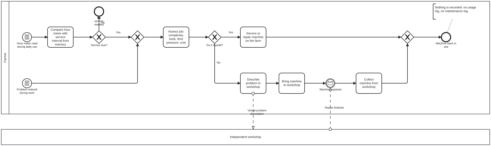
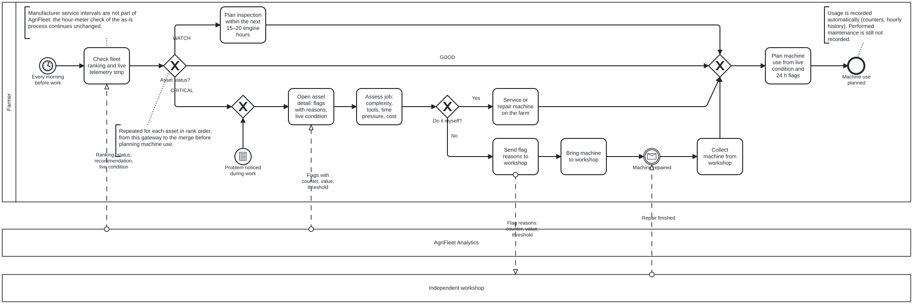

# docs\PROCESS.md

This document owns the business process models. Notation: BPMN 2.0. The `.bpmn` files in `process/` are the source; the `.svg` files are exported from them with Camunda Modeler or demo.bpmn.io.

---

## 1. As-is: maintenance planning without AgriFleet

The process has two start events. In the first, *Hour meter read during daily use*, the farmer compares the hour meter with the service interval from memory (*Check service interval*). If no service is due, the process ends with *No service needed*; if a service is due, it joins the second start event, *Problem noticed during work*. From there both triggers continue the same way: the farmer assesses the job by complexity, tools, time pressure and cost (*Assess job*) and decides *Do it myself?*. If yes, the farmer services or repairs the machine on the farm (*Service machine on farm*). If no, the farmer describes the problem to the machinery repair shop, which receives only a verbal problem description (*Describe problem*), drops the machine off there (*Drop off machine*), waits for *Machine repaired* when the machinery repair shop reports the repair as finished, and collects the machine (*Collect machine*). Both paths end with *Machine back in use*. Nothing is recorded along the way: there is no usage log and no maintenance log.

Source: the author's own farm experience (see `STAKEHOLDERS.md` §3).

---

## 2. Pain points

| # | Pain point | Where it shows in the as-is model | Addressed by |
|---|------------|-----------------------------------|--------------|
| 1 | Machines are never compared; there is no order of urgency across the fleet. | Both start events concern one machine; no step looks at the others | NEED-PRIORITISE-MAINTENANCE, NEED-MONITOR-FLEET |
| 2 | Problems are found only when someone notices them during work. | *Problem noticed during work* | NEED-OPERATIONAL-RISK |
| 3 | The machinery repair shop receives only a verbal description of the problem. | *Verbal problem description* | NEED-FLAG-REASON |
| 4 | Neither usage nor maintenance is recorded. | *Nothing is recorded* annotation | NEED-HISTORY-REVIEW, NEED-LIFETIME-HOURS (usage only) |
| 5 | The service interval is compared from memory. | *Check service interval* | Not addressed (see §4) |

---

## 3. To-be: maintenance planning with AgriFleet

*Every morning before work*, the farmer checks the fleet ranking and the live telemetry strip (*Check fleet status*), which AgriFleet Analytics fills with the ranking, status, recommendation and live condition of every machine. As the annotation on that task says, manufacturer service intervals are not part of AgriFleet, so the hour-meter check of the as-is process continues unchanged. The farmer then goes through the assets in rank order and branches on *Asset status?*. A `GOOD` asset needs no action. For a `WATCH` asset, the farmer plans an inspection within the next 15–20 engine hours (*Schedule inspection*). A `CRITICAL` asset, like the second start event *Problem noticed during work*, leads the farmer to open the asset detail, which shows the flags with their counter, value and threshold, and the live condition (*Review asset details*). The farmer then assesses the job as before (*Assess job*) and decides *Do it myself?*. If yes, the farmer services or repairs the machine on the farm (*Service machine on farm*). If no, the farmer sends the flag reasons to the machinery repair shop instead of only a verbal description (*Send flag reasons*), drops the machine off there (*Drop off machine*), waits for *Machine repaired* and collects it (*Collect machine*). Once every asset is handled, the farmer plans machine use from the live condition and the 24 h flags (*Plan machine use*), and the process ends with *Machine use planned*. Usage is recorded automatically as counters and hourly history; performed maintenance is still not recorded.

| Gateway or task | Decision in REQ-DECISIONS |
|-----------------|---------------------------|
| *Asset status?* | 1 Maintenance prioritisation |
| *Review asset details* | 1 Maintenance prioritisation |
| *Plan machine use* | 2 Short-term operational risk |

Decision 3, basic utilization awareness, supports longer-term planning and is not part of this daily process.

---

## 4. What does not change

- Manufacturer service intervals stay a manual hour-meter check.
- Performed maintenance is still not recorded; the system has no maintenance log.
- The system sends no notifications, so the farmer has to look.
- The machinery repair shop never uses the system and gets the flag reasons only through the farmer.
