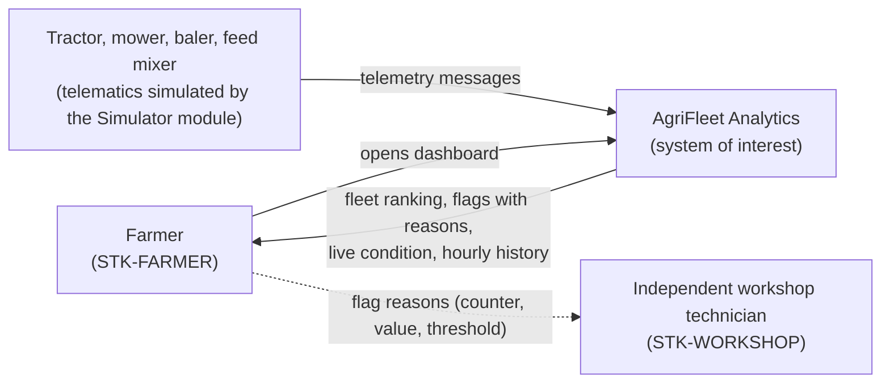
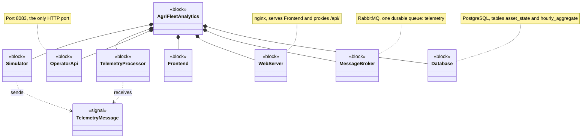
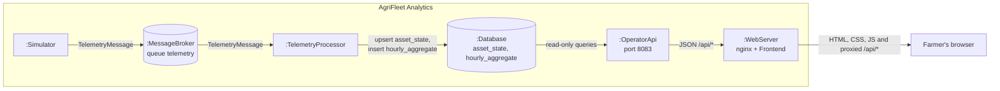
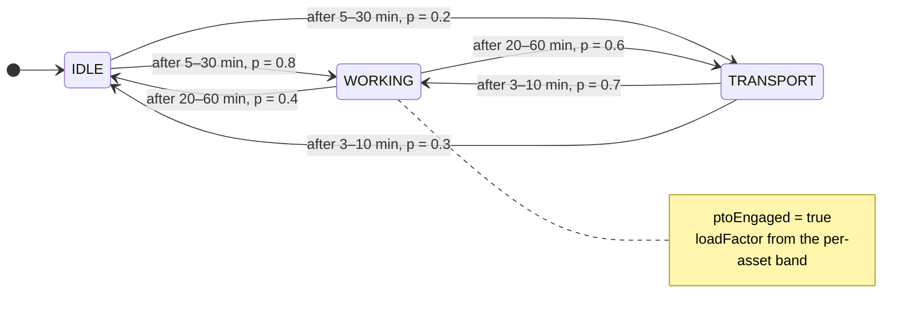
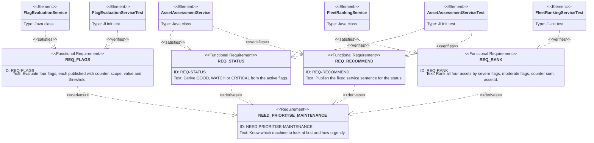

# docs\SYSTEM-MODEL.md

This document holds SysML-style views of the system, drawn in Mermaid so that they render on GitHub. Mermaid is not a SysML tool: the views borrow SysML diagram kinds and notation but are not a SysML model. They are views of `SPEC.md` and `ARCHITECTURE.md`; where a view and those documents disagree, the documents win.

| SysML diagram | Mermaid diagram type | Section |
|---------------|----------------------|---------|
| System context | `flowchart` | §1 |
| Block definition diagram | `classDiagram` | §2 |
| Internal block diagram | `flowchart` | §3 |
| State machine diagram | `stateDiagram-v2` | §4 |
| Requirement diagram | `requirementDiagram` | §5 |

---

## 1. System context

The system of interest, the machines that feed it telemetry, and the stakeholders who receive its results.

The admin (`STK-ADMIN`) has no runtime interface and is therefore not shown.

Source: `SPEC.md` §1–§2, `STAKEHOLDERS.md` §1.

---

## 2. Block definition diagram

The blocks the system is composed of and the telemetry signal that passes between them.

Source: `ARCHITECTURE.md` §1–§3.

---

## 3. Internal block diagram

How the parts of the system are connected and what flows over each connection.

Source: `ARCHITECTURE.md` §1, §3–§5.

---

## 4. State machine: simulator working cycle

The working cycle each simulated asset walks, with dwell times and transition probabilities.

Each of the four assets runs its own instance of this machine. The initial state `IDLE` is an implementation choice in `AssetSimulationState`; REQ-SIM-CYCLE does not fix it.

Source: REQ-SIM-CYCLE.

---

## 5. Requirement diagram: maintenance prioritisation slice

How one stakeholder need is refined into requirements, which classes satisfy them and which tests verify them.

Arrows follow SysML direction: `derives` points from the derived requirement to its source, `satisfies` from the implementing class to the requirement, `verifies` from the test to the requirement.

This is one slice of the full trace in `TRACEABILITY.md`. REQ-FLAGS also serves NEED-FLAG-REASON, which this slice does not show.

Source: `STAKEHOLDERS.md`, REQ-FLAGS, REQ-STATUS, REQ-RANK, REQ-RECOMMEND, `TRACEABILITY.md`.
