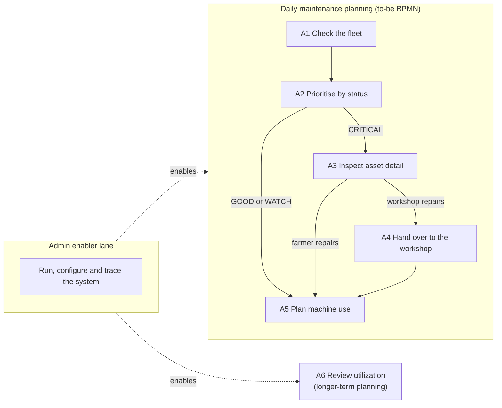

# docs\USER-STORY-MAP.md

This document owns the user stories (`US-…` IDs) and their release slices. Where a story and `SPEC.md` disagree, `SPEC.md` wins.

---

## 1. How to read this map

- **Personas** are the stakeholders in `STAKEHOLDERS.md` §1: the farmer (`STK-FARMER`), the independent workshop technician (`STK-WORKSHOP`) and the system administrator (`STK-ADMIN`). The workshop never uses the system; its stories describe what it receives through the farmer.
- **Backbone.** The columns are the farmer's activities, taken from the to-be BPMN model in `PROCESS.md` §3, in the order the farmer performs them. The admin's stories sit in a separate enabler lane: they make the backbone possible but are not steps of the farmer's process.
- **Slices.** The rows are release slices. A story's slice is the MoSCoW priority of its requirements in `SPEC.md`. All requirements of one story share the same priority. *Must* is the smallest release that supports all three decisions in REQ-DECISIONS. *Should* makes the results correct and robust. *Could* is demo tuning only. *Won't* marks deliberate scope boundaries, not planned work.
- **Story points** are relative estimates on the Fibonacci scale 1, 2, 3, 5, 8. They were made in retrospect from the implemented scope and compare stories with each other; they are not hours.
- **Traceability.** Each story names the stakeholder needs it serves (*Source*) and the requirements that realise it. Every need it names is a *Source* of at least one of those requirements. Code and tests are reached through `TRACEABILITY.md`.

---

## 2. Backbone



| Activity | To-be BPMN element (`PROCESS.md` §3) | Decision in REQ-DECISIONS |
|----------|--------------------------------------|---------------------------|
| A1 Check the fleet | *Check fleet ranking and live telemetry strip* | 1 Maintenance prioritisation |
| A2 Prioritise by status | *Asset status?*, *Plan inspection within the next 15–20 engine hours* | 1 Maintenance prioritisation |
| A3 Inspect asset detail | *Open asset detail: flags with reasons, live condition* | 1 Maintenance prioritisation |
| A4 Hand over to the workshop | *Send flag reasons to workshop* | 1 Maintenance prioritisation |
| A5 Plan machine use | *Plan machine use from live condition and 24 h flags* | 2 Short-term operational risk |
| A6 Review utilization | Annotation *Usage is recorded automatically (counters, hourly history)*; not a task of the daily process | 3 Basic utilization awareness |
| Admin enabler lane | — (the admin has no runtime interface) | — |

---

## 3. Map

Story points in brackets.

| Slice | A1 Check the fleet | A2 Prioritise by status | A3 Inspect asset detail | A4 Hand over to the workshop | A5 Plan machine use | A6 Review utilization | Admin enabler lane |
|-------|--------------------|-------------------------|-------------------------|------------------------------|---------------------|-----------------------|--------------------|
| **Must** | US-VIEW-FLEET (3) | US-RANK-FLEET (3)<br>US-SEE-STATUS (2) | US-SEE-FLAG-REASONS (5) | US-RECEIVE-FLAG-REASONS (1)<br>US-READ-LIFETIME-HOURS (2)<br>US-RECORD-USAGE-HOURLY (5) | US-CHECK-LIVE-CONDITION (3)<br>US-JUDGE-RECENT-LOAD (3) | US-COMPARE-UTILIZATION (5) | US-TRACE-EVERY-NUMBER (8)<br>US-SIMULATE-TELEMETRY (5)<br>US-STABLE-INTERFACES (3) |
| **Should** | US-WATCH-LIVE-STRIP (3) | | US-OPEN-ASSET-DETAIL (2) | US-REVIEW-HOURLY-HISTORY (3) | | | US-REALISTIC-TELEMETRY (8)<br>US-EXACT-THRESHOLDS (1) |
| **Could** | | | | | | | US-SEED-SERVICE-HISTORY (2)<br>US-DEMO-EVERY-STATUS (5) |
| **Won't** | Notifications | Manufacturer service intervals | | Workshop access | | Maintenance log | Asset registration<br>Write access, authentication |

| Slice | Stories | Points |
|-------|---------|--------|
| Must | 13 | 48 |
| Should | 5 | 17 |
| Could | 2 | 7 |
| **Total** | **20** | **72** |

---

## 4. User stories

### 4.1 Must

### US-VIEW-FLEET: See the whole fleet in one place

*Farmer · A1 · Must · 3 points · Source: NEED-MONITOR-FLEET, NEED-PRIORITISE-MAINTENANCE · Requirements: REQ-GOAL-SCOPE, REQ-FLEET-FIXED, REQ-API-ASSETS*

As a farmer, I want to see all four machines of the farm on one screen, so that I do not have to check each machine on its own.

```gherkin
Scenario: All four machines are listed
  Given the processor has published state
  When the farmer opens the dashboard
  Then the fleet ranking lists exactly TRACTOR, MOWER, BALER and MIXER
  And each machine shows its status, live condition and recommendation

Scenario: A machine that has not reported is still listed
  Given MIXER has not sent a telemetry message in this run
  When the farmer opens the dashboard
  Then MIXER is listed with live condition STALE
  And its utilizationPercent and productiveSharePercent are null

Scenario: No state yet at startup
  Given no state has been published yet
  When GET /api/assets is requested
  Then the response status is 503
```

### US-RANK-FLEET: Know which machine to look at first

*Farmer · A2 · Must · 3 points · Source: NEED-PRIORITISE-MAINTENANCE · Requirements: REQ-RANK, REQ-DECISIONS*

As a farmer, I want the fleet ranked by urgency, so that I look at the most urgent machine first.

```gherkin
Scenario: A severe flag outranks two moderate flags
  Given TRACTOR has one SEVERE flag
  And BALER has two MODERATE flags and no SEVERE flag
  When the fleet is ranked
  Then TRACTOR is ranked above BALER

Scenario: Equal flags are separated by recent load
  Given MOWER and MIXER have the same number of SEVERE and MODERATE flags
  And MOWER has the larger sum of highLoadHours, tempExcursionHours and vibrationAlertHours (24 h)
  When the fleet is ranked
  Then MOWER is ranked above MIXER

Scenario: A full tie is broken by assetId
  Given all four machines have no flags and the same counter sum
  When the fleet is ranked
  Then the ranks are BALER 1, MIXER 2, MOWER 3 and TRACTOR 4
```

### US-SEE-STATUS: Know how urgent each machine is

*Farmer · A2 · Must · 2 points · Source: NEED-PRIORITISE-MAINTENANCE · Requirements: REQ-STATUS, REQ-RECOMMEND*

As a farmer, I want a status and a service recommendation for each machine, so that I know whether to act now, plan an inspection or do nothing.

```gherkin
Scenario Outline: Status and recommendation follow the active flags
  Given a machine with <active flags>
  When its status is evaluated
  Then its status is <status>
  And its recommendation is "<recommendation>"

  Examples:
    | active flags       | status   | recommendation                                             |
    | one SEVERE flag    | CRITICAL | Priority check recommended within the next 5 engine hours. |
    | two MODERATE flags | CRITICAL | Priority check recommended within the next 5 engine hours. |
    | one MODERATE flag  | WATCH    | Plan inspection within the next 15–20 engine hours.        |
    | no active flag     | GOOD     | No inspection recommended at this time.                    |
```

### US-SEE-FLAG-REASONS: See the measured reason behind every flag

*Farmer · A3 · Must · 5 points · Source: NEED-PRIORITISE-MAINTENANCE, NEED-FLAG-REASON · Requirements: REQ-FLAGS, REQ-GOAL-TRACE*

As a farmer, I want every flag to show the counter, its value and the threshold it crossed, so that I can trust the warning and decide whether I can fix the problem myself.

```gherkin
Scenario: A moderate flag shows its reason
  Given BALER has highLoadHours (24 h) of 1.8
  When the farmer opens the BALER asset detail
  Then HEAVY_RECENT_USE is shown with severity MODERATE, counter highLoadHours, scope ROLLING_24H, value 1.8 and threshold 1.5

Scenario: Only the highest threshold reached is shown
  Given TRACTOR has vibrationAlertHours (24 h) of 2.3
  When the flags are evaluated
  Then MECHANICAL_ATTENTION is shown once, as SEVERE with threshold 2.0

Scenario: An inactive flag is absent
  Given MIXER has tempExcursionHours (24 h) of 0.5
  When the flags are evaluated
  Then no THERMAL_LOAD flag is shown for MIXER
```

### US-RECEIVE-FLAG-REASONS: Receive the measured reason instead of a verbal description

*Workshop technician · A4 · Must · 1 point · Source: NEED-FLAG-REASON · Requirements: REQ-FLAGS, REQ-GOAL-TRACE*

As a workshop technician, I want to receive from the farmer the counter, value and threshold behind each flag, so that I know why the machine was brought in without relying on a verbal description.

```gherkin
Scenario: Flag reasons travel with the machine
  Given TRACTOR is CRITICAL and the farmer brings it to the workshop
  When the farmer passes on the flags from the asset detail
  Then the technician receives the counter, scope, value and threshold of every active flag
  And every value is a counter accrued from telemetry, with no hidden score or weighting
```

### US-READ-LIFETIME-HOURS: Know how much a machine has worked in its life

*Workshop technician · A4 · Must · 2 points · Source: NEED-LIFETIME-HOURS · Requirements: REQ-SCOPES*

As a workshop technician, I want the lifetime hours of a machine, including its hours under load, so that I can judge its wear.

```gherkin
Scenario: Lifetime and recent counters are shown separately
  When the TRACTOR asset detail is opened
  Then all eight counters are shown in the lifetime scope and in the rolling 24-hour scope

Scenario: Lifetime load drives the cumulative flag
  Given TRACTOR has loadedHours (lifetime) of 981.4
  When the flags are evaluated
  Then HIGH_CUMULATIVE_LOAD is MODERATE with scope LIFETIME and threshold 850.0
```

### US-RECORD-USAGE-HOURLY: Have usage recorded without anyone writing it down

*Workshop technician · A4 · Must · 5 points · Source: NEED-HISTORY-REVIEW · Requirements: REQ-BUCKETS*

As a workshop technician, I want a machine's usage recorded automatically hour by hour, so that I can see how it was used without depending on the farmer's memory.

```gherkin
Scenario: A message is credited to the hour of its own timestamp
  Given the previous BALER message was at 09:59:50 Europe/Vienna time
  When the next BALER message arrives with timestamp 10:00:30
  Then the whole 40 seconds are credited to the bucket that starts at 10:00

Scenario: A bucket holds what was accrued within that hour
  When an hourly bucket is completed
  Then it holds, for each of the eight counters, the amount accrued within that hour and not a running total
```

### US-CHECK-LIVE-CONDITION: Know whether a machine is in trouble right now

*Farmer · A5 · Must · 3 points · Source: NEED-OPERATIONAL-RISK · Requirements: REQ-LIVE*

As a farmer, I want each machine's condition from its latest reading, so that I stop working a machine that is under strain right now.

```gherkin
Scenario Outline: Live condition comes from the latest reading only
  Given the latest MOWER message is less than 60 seconds old
  And it has <reading>
  When the live condition is derived
  Then the live condition is <liveCondition>

  Examples:
    | reading                  | liveCondition |
    | vibrationLevel HIGH      | ALERT         |
    | temperatureC 96          | ALERT         |
    | vibrationLevel ELEVATED  | CAUTION       |
    | loadFactor 0.92          | CAUTION       |
    | no unusual value         | NORMAL        |

Scenario: A silent machine is stale
  Given the latest BALER message is more than 60 seconds old
  When the live condition is derived
  Then the live condition is STALE

Scenario: Live condition does not change the status
  Given MOWER has status GOOD
  When its latest reading has vibrationLevel HIGH
  Then its live condition is ALERT
  And its status, rank and recommendation are unchanged
```

### US-JUDGE-RECENT-LOAD: Know how hard a machine was worked recently

*Farmer · A5 · Must · 3 points · Source: NEED-OPERATIONAL-RISK · Requirements: REQ-SCOPES, REQ-DECISIONS*

As a farmer, I want to see the sustained load of the last 24 hours, so that I can decide whether to keep working a machine hard today.

```gherkin
Scenario: Recent overheating raises a rolling flag
  Given TRACTOR has tempExcursionHours of 1.6 within the rolling 24-hour window
  When the flags are evaluated
  Then THERMAL_LOAD is SEVERE with scope ROLLING_24H

Scenario: Old load leaves the rolling window
  Given the rolling window is the current hour plus the 23 completed hours before it
  And all of MOWER's high-load time lies in hours before that window
  When the flags are evaluated
  Then HEAVY_RECENT_USE is not active for MOWER
```

### US-COMPARE-UTILIZATION: See which machines do productive work

*Farmer · A6 · Must · 5 points · Source: NEED-UTILIZATION-AWARENESS · Requirements: REQ-TELEMETRY-PRODUCTIVE, REQ-COUNTER-SET, REQ-UTILIZATION, REQ-DECISIONS*

As a farmer, I want to see which machines do productive work and which mostly idle or only transport, so that I can plan how the fleet is used.

```gherkin
Scenario: Productive work comes from PTO and ground speed
  Given a message with ptoEngaged true, groundSpeedKmh 1.5 and workingStatus WORKING
  When the message is accumulated
  Then its interval is credited to idleHours and not to totalWorkingHours

Scenario: Two utilization percentages
  Given BALER has totalWorkingHours (24 h) of 6.0, engineHours (24 h) of 8.0 and windowCoverageHours of 12.0
  When utilization is published
  Then utilizationPercent is 50.0
  And productiveSharePercent is 75.0

Scenario: No percentage without a denominator
  Given MIXER has not reported in this run
  When utilization is published
  Then utilizationPercent and productiveSharePercent are null
```

### US-TRACE-EVERY-NUMBER: Explain every number by one fixed rule

*Admin · Admin lane · Must · 8 points · Source: NEED-TRACEABLE-RULES · Requirements: REQ-GOAL-TRACE, REQ-COUNTER-SET, REQ-COUNTER-INVARIANT, REQ-ACCUMULATE*

As an admin, I want every number on the dashboard to come from a counter that is accrued by one fixed rule, so that I can explain and check any result by hand.

```gherkin
Scenario: A duplicate or out-of-order message changes nothing
  Given the last processed MOWER timestamp is 10:00:00
  When a MOWER message with timestamp 09:59:55 arrives
  Then no counter changes
  And the last processed timestamp stays 10:00:00

Scenario: A gap above 60 seconds credits nothing
  Given the last processed MOWER timestamp is 10:00:00
  When the next MOWER message has timestamp 10:02:00
  Then no counter changes, engineHours included
  And the last processed timestamp becomes 10:02:00

Scenario: The counters stay consistent
  When any message has been accumulated
  Then engineHours equals totalWorkingHours + transportHours + idleHours
  And totalWorkingHours >= loadedHours >= highLoadHours
```

### US-SIMULATE-TELEMETRY: Run the system without real machines

*Admin · Admin lane · Must · 5 points · Source: NEED-REPRODUCIBLE-DEMO · Requirements: REQ-SIM-ONLY-SOURCE, REQ-SIM-CYCLE*

As an admin, I want a simulator that is the only telemetry source and walks each machine through a working cycle, so that the system can be run and shown without real machines.

```gherkin
Scenario: Each machine walks its own working cycle
  Given the simulator is running
  Then each machine moves between WORKING, TRANSPORT and IDLE with the dwell times and probabilities of REQ-SIM-CYCLE
  And while WORKING, ptoEngaged is true and loadFactor lies in that machine's working band, for TRACTOR 0.30–0.90

Scenario: The simulator is the only source
  When the processor receives a telemetry message
  Then it was published by the simulator
```

### US-STABLE-INTERFACES: Change one module without breaking the others

*Admin · Admin lane · Must · 3 points · Source: NEED-STABLE-INTERFACE · Requirements: REQ-TELEMETRY-SHAPE, REQ-API-COMMON*

As an admin, I want a fixed telemetry message format and a read-only REST API, so that the modules and the frontend can be changed without breaking each other.

```gherkin
Scenario: A telemetry message has a fixed shape
  When the simulator publishes a message
  Then it has exactly the fields assetId, timestamp, ptoEngaged, groundSpeedKmh, loadFactor, temperatureC, vibrationLevel and workingStatus
  And groundSpeedKmh is at least 0 and loadFactor lies between 0.0 and 1.0

Scenario: The API only reads
  When any of GET /api/assets, GET /api/assets/{assetId}, GET /api/history or GET /api/telemetry/latest is called
  Then no system state changes
  And no authentication is required
```

### 4.2 Should

### US-WATCH-LIVE-STRIP: See every machine's newest reading at a glance

*Farmer · A1 · Should · 3 points · Source: NEED-OPERATIONAL-RISK · Requirements: REQ-API-LATEST*

As a farmer, I want a live strip with each machine's newest reading, so that I see at a glance which machine is under strain right now.

```gherkin
Scenario: The strip works before any state exists
  Given no state has been published yet
  When GET /api/telemetry/latest is requested
  Then the response status is 200
  And all four machines are listed in assetId order, each STALE with telemetry null

Scenario: A silent machine keeps its last reading
  Given BALER reported and then fell silent for more than 60 seconds
  When the live strip is refreshed
  Then BALER is STALE
  And its last reading is still shown
```

### US-OPEN-ASSET-DETAIL: Open one machine on its own

*Farmer · A3 · Should · 2 points · Source: NEED-FLAG-REASON · Requirements: REQ-API-ASSET*

As a farmer, I want to open one machine on its own, so that I can read its flags, counters and live condition before deciding who repairs it.

```gherkin
Scenario: A known machine
  When GET /api/assets/BALER is requested
  Then the response status is 200
  And the body has the same shape as one element of GET /api/assets

Scenario: An unknown machine
  When GET /api/assets/PLOUGH is requested
  Then the response status is 404

Scenario: A known machine without state
  Given no state has been published for BALER
  When GET /api/assets/BALER is requested
  Then the response status is 503
```

### US-REVIEW-HOURLY-HISTORY: Review how a machine was used hour by hour

*Workshop technician · A4 · Should · 3 points · Source: NEED-HISTORY-REVIEW · Requirements: REQ-API-HISTORY*

As a workshop technician, I want to review a machine's usage hour by hour over the past days, so that I understand how it was worked before it came in.

```gherkin
Scenario: Hourly rows for a period
  When GET /api/history is requested for BALER from 06:00Z to 09:00Z
  Then the response has one row per hour that overlaps the period, ordered by hourStart
  And each row holds the amount accrued within that hour

Scenario: The period is limited to 7 days
  When GET /api/history is requested for a range of 7 days and 1 second
  Then the response status is 400
  But a range of exactly 7 days is accepted

Scenario: Unknown machine and empty result
  When GET /api/history is requested with assetId PLOUGH
  Then the response status is 404
  But a valid request without matching hours returns 200 with an empty rows list
```

### US-REALISTIC-TELEMETRY: Have readings behave like a real machine

*Admin · Admin lane · Should · 8 points · Source: NEED-REPRODUCIBLE-DEMO, NEED-STABLE-INTERFACE, NEED-UTILIZATION-AWARENESS · Requirements: REQ-TELEMETRY-CADENCE, REQ-TELEMETRY-WORKING-STATUS, REQ-SIM-TEMPERATURE, REQ-SIM-VIBRATION, REQ-SIM-EXCURSION-RATE, REQ-SIM-ELEVATED, REQ-SIM-MEMORY*

As an admin, I want the simulated readings to behave plausibly over time, so that flags, live condition and utilization react the way they would on a real machine.

```gherkin
Scenario: Working status matches PTO and ground speed
  When the simulator generates a message
  Then workingStatus is WORKING exactly when ptoEngaged is true and groundSpeedKmh > 2

Scenario: Temperature and vibration excursions
  Given a machine is WORKING
  Then temperatureC drifts within 70–85 °C outside a thermal excursion and is 91–98 °C during one
  And vibrationLevel is ELEVATED while loadFactor >= 0.85, so the same message also accrues highLoadHours
  And excursion chances apply per minute of working time, not per message

Scenario: Steady cadence and a fresh start
  Given the startup burst has finished
  Then each machine publishes one message every 5–10 seconds, independently of the others
  And after a restart the simulator state starts fresh
```

### US-EXACT-THRESHOLDS: Compare thresholds without rounding errors

*Admin · Admin lane · Should · 1 point · Source: NEED-TRACEABLE-RULES · Requirements: REQ-BUCKET-EXACT*

As an admin, I want buckets to hold exact seconds, so that a threshold comparison never flips because of rounding.

```gherkin
Scenario: A value exactly on the threshold
  Given the rolling buckets of BALER hold exactly 5400 seconds of highLoadHours
  When the flags are evaluated
  Then highLoadHours (24 h) is exactly 1.5
  And HEAVY_RECENT_USE is MODERATE
```

### 4.3 Could

### US-SEED-SERVICE-HISTORY: Start every run from a known service history

*Admin · Admin lane · Could · 2 points · Source: NEED-LIFETIME-HOURS, NEED-REPRODUCIBLE-DEMO · Requirements: REQ-BASELINES*

As an admin, I want every run to start from a fixed service history per machine, so that the lifetime flag is reachable in a demo and every run starts the same way.

```gherkin
Scenario: Baselines before any telemetry
  Given the processor has just started and no telemetry has arrived
  Then TRACTOR's lifetime counters equal its baseline, with engineHours 6200 and loadedHours 980
  And TRACTOR is WATCH on HIGH_CUMULATIVE_LOAD alone and the other three machines are GOOD
  And the rolling 24-hour window is empty

Scenario: No carry-over between runs
  When the processor restarts
  Then the lifetime counters start again from the baseline table
```

### US-DEMO-EVERY-STATUS: Show every status within one demo session

*Admin · Admin lane · Could · 5 points · Source: NEED-REPRODUCIBLE-DEMO · Requirements: REQ-SIM-DEMO, REQ-SIM-BURST*

As an admin, I want the simulator to fill the last 24 hours at startup and to aim each machine at a known status, so that one demo session shows GOOD, WATCH and CRITICAL.

```gherkin
Scenario: The startup burst fills the window
  Given simulator.backfill.hours is 24, the default
  When the simulator starts
  Then each machine publishes one message per simulated minute for the 24 hours before now
  And then switches to the live cadence
  And no timestamp lies before the window

Scenario: Machines are aimed at known statuses
  Given a full 24-hour window
  Then TRACTOR is aimed at CRITICAL, BALER at WATCH on HEAVY_RECENT_USE alone and MIXER at GOOD
  And MOWER can move between GOOD, WATCH and CRITICAL
  But a single random run is not required to land on every anchor
```

---

## 5. Won't have (scope boundary)

These are deliberate limits of the system, not planned work.

| Won't have | Column | Why | Source |
|------------|--------|-----|--------|
| Notifications | A1 | The farmer checks the dashboard every morning; the system sends nothing. | `PROCESS.md` §4 |
| Manufacturer service intervals | A2 | The hour-meter check of the as-is process continues unchanged. | `PROCESS.md` §4 |
| Workshop access | A4 | The workshop never uses the system and gets the flag reasons only through the farmer. | `PROCESS.md` §4 |
| Maintenance log | A6 | Usage is recorded; performed maintenance is not. | `PROCESS.md` §4 |
| Asset registration | Admin lane | The fleet is fixed to four machines. | REQ-FLEET-FIXED |
| Write access, authentication | Admin lane | The API is read-only and open. | REQ-API-COMMON |

---

## 6. Definition of Done

A story is done when all of the following are true for each of its requirements:

1. The code that implements the requirement cites its `REQ-` ID in a comment.
2. The requirement has a row in `TRACEABILITY.md` §2, and the story appears in `TRACEABILITY.md` §1.
3. Every unit test whose `@DisplayName` starts with the `REQ-` ID passes. A requirement without a test is listed in `TRACEABILITY.md` §3, so the gap stays visible.
4. The story's scenarios can be shown on the running system (`RUNNING.md`).
5. Every new identifier is named in `GLOSSARY.md`.
