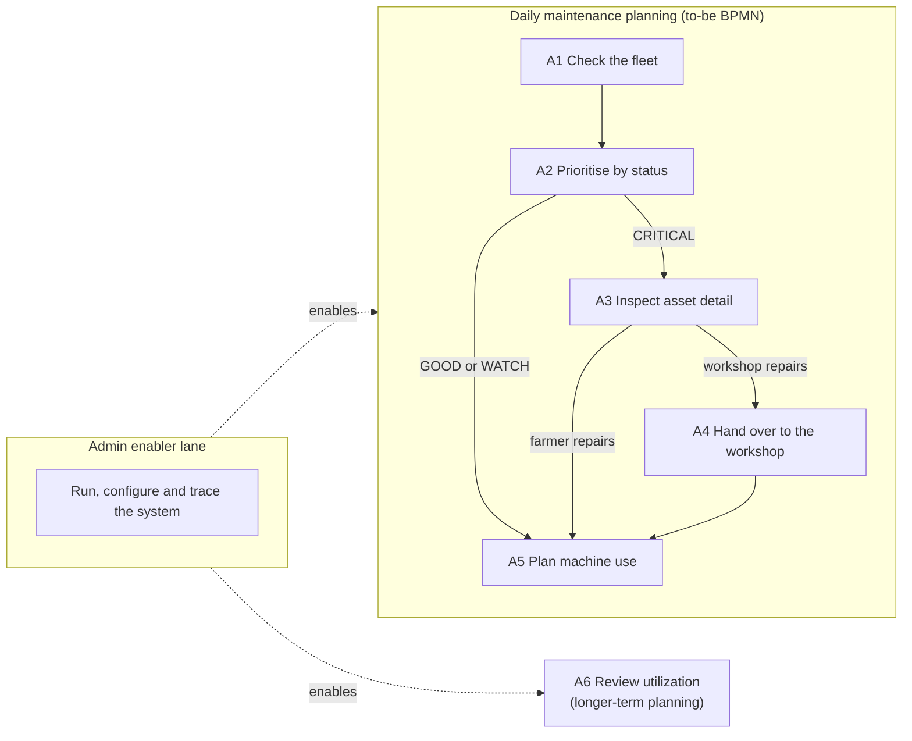

# docs\USER-STORY-MAP.md

This document owns the user stories (`US-…` IDs) and their release slices. Where a story and `SPEC.md` disagree, `SPEC.md` wins.

---

## 1. How to read this map

- **Personas** are the stakeholders in `STAKEHOLDERS.md` §1: the farmer (`STK-FARMER`), the independent workshop technician (`STK-WORKSHOP`) and the system administrator (`STK-ADMIN`). The workshop never uses the system; its stories describe what it receives through the farmer.
- **Backbone.** The columns are the farmer's activities, taken from the to-be BPMN model in `PROCESS.md` §3, in the order the farmer performs them. The admin's stories sit in a separate enabler lane: they make the backbone possible but are not steps of the farmer's process.
- **Slices.** The rows are release slices. A story's slice is the MoSCoW priority of its requirements in `SPEC.md`. All requirements of one story share the same priority. *Must* is the smallest release that supports all three decisions in REQ-DECISIONS. *Should* makes the results correct and robust. *Could* is demo tuning only. *Won't* marks deliberate scope boundaries, not planned work.
- **Story points** are relative estimates on the Fibonacci scale 1, 2, 3, 5, 8. They were made in retrospect from the implemented scope and compare stories with each other; they are not hours.
- **Traceability.** Each story names the stakeholder needs it serves (*Source*) and the requirements that realise it. Every need it names is a *Source* of at least one of those requirements. Code and tests are reached through `TRACEABILITY.md`.
- **Acceptance.** A story is accepted through its requirements: the *shall* statements in `SPEC.md` are the acceptance criteria, and `TRACEABILITY.md` §2 names the test or other method that verifies each one.

---

## 2. Backbone

| Activity | To-be BPMN element (`PROCESS.md` §3) | Decision in REQ-DECISIONS |
|----------|--------------------------------------|---------------------------|
| A1 Check the fleet | *Check fleet ranking and live telemetry strip* | 1 Maintenance prioritisation |
| A2 Prioritise by status | *Asset status?*, *Plan inspection within the next 15–20 engine hours* | 1 Maintenance prioritisation |
| A3 Inspect asset detail | *Open asset detail: flags with reasons, live condition* | 1 Maintenance prioritisation |
| A4 Hand over to the workshop | *Send flag reasons to workshop* | 1 Maintenance prioritisation |
| A5 Plan machine use | *Plan machine use from live condition and 24 h flags* | 2 Short-term operational risk |
| A6 Review utilization | Annotation *Usage is recorded automatically (counters, hourly history)*; not a task of the daily process | 3 Basic utilization awareness |
| Admin enabler lane | — (the admin has no runtime interface) | — |

---

## 3. Map

Story points in brackets.

| Slice | A1 Check the fleet | A2 Prioritise by status | A3 Inspect asset detail | A4 Hand over to the workshop | A5 Plan machine use | A6 Review utilization | Admin enabler lane |
|-------|--------------------|-------------------------|-------------------------|------------------------------|---------------------|-----------------------|--------------------|
| **Must** | US-VIEW-FLEET (3) | US-RANK-FLEET (3) US-SEE-STATUS (2) | US-SEE-FLAG-REASONS (5) US-OPEN-ASSET-DETAIL (2) | US-RECEIVE-FLAG-REASONS (1) US-READ-LIFETIME-HOURS (2) US-RECORD-USAGE-HOURLY (5) | US-CHECK-LIVE-CONDITION (3) US-JUDGE-RECENT-LOAD (3) | US-COMPARE-UTILIZATION (5) | US-TRACE-EVERY-NUMBER (8) US-SIMULATE-TELEMETRY (5) US-STABLE-INTERFACES (3) |
| **Should** | US-WATCH-LIVE-STRIP (3) | | | US-REVIEW-HOURLY-HISTORY (3) | | | |
| **Could** | | | | | | | US-SEED-SERVICE-HISTORY (2) US-DEMO-EVERY-STATUS (5) |
| **Won't** | Notifications | Manufacturer service intervals | | Workshop access | | Maintenance log | Asset registration Write access, authentication |

| Slice | Stories | Points |
|-------|---------|--------|
| Must | 14 | 50 |
| Should | 2 | 6 |
| Could | 2 | 7 |
| **Total** | **18** | **63** |

---

## 4. User stories

| ID | Persona · activity · points | Story | Source | Requirements |
|----|-----------------------------|-------|--------|--------------|
| **Must** | | | | |
| `US-VIEW-FLEET` | Farmer · A1 · 3 | I want to see all four machines on one screen, so that I do not have to check each machine on its own. | NEED-MONITOR-FLEET, NEED-PRIORITISE-MAINTENANCE | REQ-GOAL-SCOPE, REQ-API-ASSETS |
| `US-RANK-FLEET` | Farmer · A2 · 3 | I want the fleet ranked by urgency, so that I look at the most urgent machine first. | NEED-PRIORITISE-MAINTENANCE | REQ-RANK, REQ-DECISIONS |
| `US-SEE-STATUS` | Farmer · A2 · 2 | I want a status and a service recommendation for each machine, so that I know whether to act now, plan an inspection or do nothing. | NEED-PRIORITISE-MAINTENANCE | REQ-STATUS, REQ-RECOMMEND |
| `US-SEE-FLAG-REASONS` | Farmer · A3 · 5 | I want every flag to show the counter, its value and the threshold, so that I can trust the warning and decide whether I can fix the problem myself. | NEED-PRIORITISE-MAINTENANCE, NEED-FLAG-REASON | REQ-FLAGS, REQ-GOAL-TRACE |
| `US-OPEN-ASSET-DETAIL` | Farmer · A3 · 2 | I want to open one machine on its own, so that I can read its flags, counters and live condition before deciding who repairs it. | NEED-FLAG-REASON | REQ-API-ASSETS |
| `US-RECEIVE-FLAG-REASONS` | Workshop technician · A4 · 1 | I want to receive the counter, value and threshold behind each flag, so that I know why the machine was brought in without relying on a verbal description. | NEED-FLAG-REASON | REQ-FLAGS, REQ-GOAL-TRACE |
| `US-READ-LIFETIME-HOURS` | Workshop technician · A4 · 2 | I want the lifetime hours of a machine, including its hours under heavy load, so that I can judge its wear. | NEED-LIFETIME-HOURS | REQ-SCOPES |
| `US-RECORD-USAGE-HOURLY` | Workshop technician · A4 · 5 | I want a machine's usage recorded automatically hour by hour, so that I can see how it was used without depending on the farmer's memory. | NEED-HISTORY-REVIEW | REQ-BUCKETS |
| `US-CHECK-LIVE-CONDITION` | Farmer · A5 · 3 | I want each machine's condition from its latest reading, so that I stop working a machine that is under strain right now. | NEED-OPERATIONAL-RISK | REQ-LIVE |
| `US-JUDGE-RECENT-LOAD` | Farmer · A5 · 3 | I want to see the sustained load of the last 24 hours, so that I can decide whether to keep working a machine hard today. | NEED-OPERATIONAL-RISK | REQ-SCOPES, REQ-DECISIONS |
| `US-COMPARE-UTILIZATION` | Farmer · A6 · 5 | I want to see which machines do productive work and which mostly run without working, so that I can plan how the fleet is used. | NEED-UTILIZATION-AWARENESS | REQ-COUNTER-SET, REQ-UTILIZATION, REQ-DECISIONS |
| `US-TRACE-EVERY-NUMBER` | Admin · enabler · 8 | I want every number on the dashboard to come from a counter accrued by one fixed, exact rule, so that I can explain and check any result by hand. | NEED-TRACEABLE-RULES | REQ-GOAL-TRACE, REQ-COUNTER-SET, REQ-ACCUMULATE, REQ-BUCKETS |
| `US-SIMULATE-TELEMETRY` | Admin · enabler · 5 | I want a simulator that is the only telemetry source and repeats a fixed schedule per machine, so that the system can be run and shown without real machines. | NEED-REPRODUCIBLE-DEMO | REQ-SIM-SCHEDULE |
| `US-STABLE-INTERFACES` | Admin · enabler · 3 | I want a fixed telemetry message format and a read-only REST API, so that the modules and the frontend can be changed without breaking each other. | NEED-STABLE-INTERFACE | REQ-TELEMETRY-SHAPE, REQ-API-COMMON |
| **Should** | | | | |
| `US-WATCH-LIVE-STRIP` | Farmer · A1 · 3 | I want a live strip with each machine's newest reading, so that I see at a glance which machine is under strain right now. | NEED-OPERATIONAL-RISK | REQ-API-LATEST |
| `US-REVIEW-HOURLY-HISTORY` | Workshop technician · A4 · 3 | I want to review a machine's usage hour by hour over the past days, so that I understand how it was worked before it came in. | NEED-HISTORY-REVIEW | REQ-API-HISTORY |
| **Could** | | | | |
| `US-SEED-SERVICE-HISTORY` | Admin · enabler · 2 | I want every run to start from a fixed service history per machine, so that the lifetime flag is reachable in a demo and every run starts the same way. | NEED-LIFETIME-HOURS, NEED-REPRODUCIBLE-DEMO | REQ-BASELINES |
| `US-DEMO-EVERY-STATUS` | Admin · enabler · 5 | I want the simulator to fill the last 24 hours at startup and land each machine on a known status, so that one demo session shows GOOD, WATCH and CRITICAL. | NEED-REPRODUCIBLE-DEMO | REQ-SIM-DEMO, REQ-SIM-BURST |

---

## 5. Won't have (scope boundary)

These are deliberate limits of the system, not planned work.

| Won't have | Column | Why | Source |
|------------|--------|-----|--------|
| Notifications | A1 | The farmer checks the dashboard every morning; the system sends nothing. | `PROCESS.md` §4 |
| Manufacturer service intervals | A2 | The hour-meter check of the as-is process continues unchanged. | `PROCESS.md` §4 |
| Workshop access | A4 | The workshop never uses the system and gets the flag reasons only through the farmer. | `PROCESS.md` §4 |
| Maintenance log | A6 | Usage is recorded; performed maintenance is not. | `PROCESS.md` §4 |
| Asset registration | Admin lane | The fleet is fixed to four machines. | REQ-GOAL-SCOPE |
| Write access, authentication | Admin lane | The API is read-only and open. | REQ-API-COMMON |

---

## 6. Definition of Done

A story is done when all of the following are true for each of its requirements:

1. The code that implements the requirement cites its `REQ-` ID in a comment.
2. The requirement has a row in `TRACEABILITY.md` §2, and the story appears in `TRACEABILITY.md` §1.
3. The requirement is verified by the method named in `TRACEABILITY.md` §2: every unit test whose `@DisplayName` starts with the `REQ-` ID passes, and an inspection or demonstration has been carried out.
4. The story can be shown on the running system (`RUNNING.md`).
5. Every new identifier is named in `GLOSSARY.md`.
